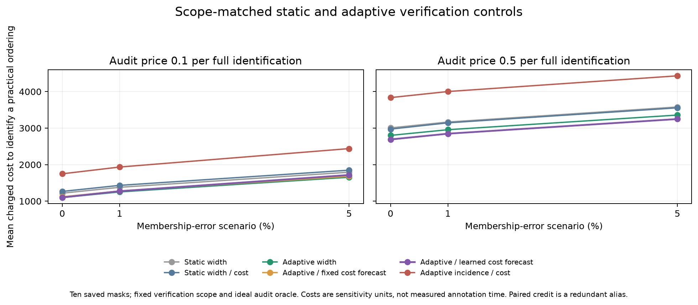

# T4 results: matched static and adaptive verification controls

Completed 21 November 2026. This is development on the already consumed T2/T3
cohort, with one fixed predictor and two fixed 4,201-cell acceptance sets. The
[protocol](adaptive_baselines_t4_protocol.md), configuration, scientific sources,
validator and plotting code were frozen before the main replay. All original
T2/T3 sources and failed criteria remain unchanged.

## Main conclusion

**The static paired-width score is not a distinct method in this equal-quota
setting.** An ordinary width score, restricted to the same actual verification
scope, differs only by a positive constant. Generic adaptive controls lower
charged cost, but the named learned-cost control misses the predefined 10%
reference target in all four nonzero-error/price strata. Updating interval widths
helps; learning the mismatch forecast has little consistent incremental value.
This closes the standalone static-score novelty branch and favors a narrower
empirical measurement/verification-cost paper.

## Why the old score is redundant

For the two binary selectors A and B, both accepting n=4,201 cells,
`w_i = (A_i - B_i)/n`. Every nonzero absolute weight is therefore `1/n`.
For the same observable cell/genus credit c and the same queried group scope S,
the paired priority is `sum_{i in S} c_i/n`, while scope-restricted ordinary width
uses `sum_{i in S} c_i`. Dividing both by the same expected cost preserves this
identity. It also holds after revealed labels if both names use the same state.
This is elementary algebra for this setting, not a new theorem or a statement
about arbitrary unequal quotas/weights.

T3's global-width ordering valued members its scoped verifier did not verify.
Matching that objective and scope removes the supposed distinction. Across all
30 saved catalogs, maximum unscaled numerical score discrepancy is
**3.553e-15**. IEEE rescaling changes some tied ranking positions in 11 cases;
T4 uses canonical unscaled sums and common tie breaks. These differences are
not method gains. All 60 T4 static-width first-ordering costs exactly match the
saved T3 paired-width costs when repriced at the same prices, despite the
preflight tie sensitivity. See `equivalence_preflight.json`, `equivalence.csv`
and `frozen_T3_numeric_comparison.csv` in the result directory.

## Executed design and cost meaning

Six transparent controls compare static/adaptive width, expected-cost division,
fixed/learned mismatch forecasts and adaptive active-member incidence. All use
the same **fixed initial comparison-member verification scope**, representative
rule, perfect target-label audit and mismatch identification charges. Adaptive
orders refresh after batches of 32 groups. No arm sees an identity before its
query. Predictions, target universe and initial censored records are unchanged.

Ten saved masks × three membership-error scenarios (0/1/5%) × two audit prices
(.1/.5) × six controls give **360 priced paths**. The two price-independent
orders are reused at the second price: **300 executed query trajectories and
60 reprices**, not 360 independent experiments. The replay took **365.26 CPU
seconds**, recording 14,835 curve points. There were **zero new model fits,
inference jobs, GPU jobs or competition submissions**.

A full identification costs one unit; a binary audit costs .1 or .5 units.
Mismatched followers require an additional full identification. These are
sensitivity assumptions, not measured field annotation times. The prior mean
mismatch forecast is .05; the learned forecast updates from paid observed
audit/resolution counters. Under selective querying it is a heuristic, not a
calibrated estimate of a population linkage-error rate.

## Declared empirical comparison

The primary endpoint is charged cost to first identify the finite-cohort
contrast beyond the practical ±.001 F1 margin. The learned adaptive-width/cost
control is compared with the **best of the two static controls for each mask**.
This oracle minimum is a conservative evaluation reference, not a deployable
per-mask selector. The frozen gate requires at least 10% lower mean cost and
improvement on at least eight of ten masks in **each** nonzero-error/price stratum.

| Membership error | Audit price | Mean best-static cost | Mean learned adaptive cost | Mean cost reduction | Masks cheaper | Gate |
|---|---:|---:|---:|---:|---:|---|
| 1% | .1 | 1,379.06 | 1,273.16 | **7.68%** | 10/10 | Fail |
| 1% | .5 | 3,130.10 | 2,847.60 | **9.03%** | 10/10 | Fail |
| 5% | .1 | 1,792.69 | 1,716.59 | **4.25%** | 10/10 | Fail |
| 5% | .5 | 3,541.30 | 3,248.75 | **8.26%** | 10/10 | Fail |

All differences favor the adaptive control, but their magnitude fails the
declared operational criterion. The 4,000-draw mask-bootstrap intervals for
mean unit savings are respectively [86.19,125.38], [256.95,307.40],
[52.64,97.35] and [258.40,323.10]. They describe mask variation conditional on
these data and fits; they are not spatial-population or fitted-model uncertainty.
No threshold or prior was changed after replay to obtain success.

## Every control and the ablation result

The table gives mean charged cost at the same first-ordering endpoint.

| Control | 1%, .1 | 1%, .5 | 5%, .1 | 5%, .5 |
|---|---:|---:|---:|---:|
| Static scope width | 1,379.06 | 3,166.50 | 1,792.69 | 3,578.65 |
| Static scope width / forecast cost | 1,432.30 | 3,144.60 | 1,848.48 | 3,556.05 |
| Adaptive scope width | **1,252.93** | 2,956.25 | **1,654.70** | 3,357.50 |
| Adaptive width / fixed cost forecast | 1,277.34 | **2,846.30** | 1,680.53 | **3,248.75** |
| Adaptive width / learned cost forecast | 1,273.16 | 2,847.60 | 1,716.59 | **3,248.75** |
| Adaptive incidence / learned cost forecast | 1,934.15 | 4,001.75 | 2,439.15 | 4,431.75 |

Updating width information is useful in these scenarios. Cost normalization
becomes more useful at the higher audit price. Learning the forecast does not
consistently beat keeping it fixed: learned-minus-fixed mean costs are −4.18,
+1.30, +36.06 and 0.00 in the four columns. The simpler adaptive width control
is cheapest at the lower price; there is no uniformly best named adaptive arm.
The incidence control is worse here, without implying that all incidence-based
or established active-testing methods are inferior.

The secondary endpoint is range width <=.002. All paths reach both endpoints;
there is no endpoint censoring. `cost_summary.csv` includes all six controls,
zero-error scenarios, both endpoints and operation counts. The learned control's
mean width-endpoint costs in the four nonzero-error strata are 1,707.36,
3,596.70, 2,157.84 and 4,044.30. These secondary results do not replace the gate.



The figure shows mean costs over ten saved masks, including zero-error scenarios.
Overlapping curves are retained. [Standalone PDF](../results/adaptive_baselines_t4/adaptive_costs_t4.pdf).

## Validation and reproducibility

- All **426 local tests** pass, with no failures, errors or skips; three upstream
  dependency warnings remain. The focused pre-freeze run passes 29 tests,
  including nine new semantic tests. Main-suite runtime is 275.60 seconds.
- Replay reports **zero oracle-containment failures** and **zero incorrect known
  labels at endpoints** under the ideal audit contract. All recorded paths have
  valid finite-cohort orderings and contracting ranges.
- Independent reconstruction checks **288 dense endpoint/preceding prefixes**,
  **108 batch choices** and **720 charged-operation endpoints**, plus all 360
  order hashes, chronology, 60 reused paths and 30 score-identity cases. This
  verifies this execution, not field truth or external validity.
- The final artifact manifest seals source/input locks, reports, validation,
  documentation snapshots and hashes of ignored local traces. Earlier study
  manifests are reverified without changing their files.

After restoring the documented ignored inputs, run from the repository with
Python 3.12 and the research environment:

```bash
python scripts/verify_adaptive_baselines_t4.py
```

The completed replay refuses overwrite. Its sources are snapshotted under
`results/adaptive_baselines_t4/source_snapshot/`. Scientific summary/validation
artifacts are public; private arrays, query traces, credentials and agent notes
are ignored. A hash manifest does not distribute those data.

## What this earns, and the next step

T4 strengthens the audit by removing a redundant candidate score, holding actual
query information/scope/cost equal, and reporting dynamic-width and cost-forecast
ablations. It does **not** establish a new algorithm, a faithful VMA/LURE
implementation, superiority over published active-testing methods, field cost
savings or fresh confirmation. Perfect audits, correct genus/category semantics
and complete recorded benchmark inventories remain assumptions. Recorded labels
are not perfect occupancy truth.

Two proposed evidence packages remain: **model/source replication** of these
measurement/cost findings and **separately uninspected external confirmation with
a record/cost audit**. Their exact budgets require feasibility checks and new
freezes before outcome access. Do not search more priors, seeds or GPU models to
repair this failed gate. The thesis can plausibly support an empirical paper if
the narrow contribution survives replication and prior-work review; it does not
yet justify a strong new-method paper. See [paper status](thesis_paper_status.md)
and [next-study budget](next_experiment_budget.md).
