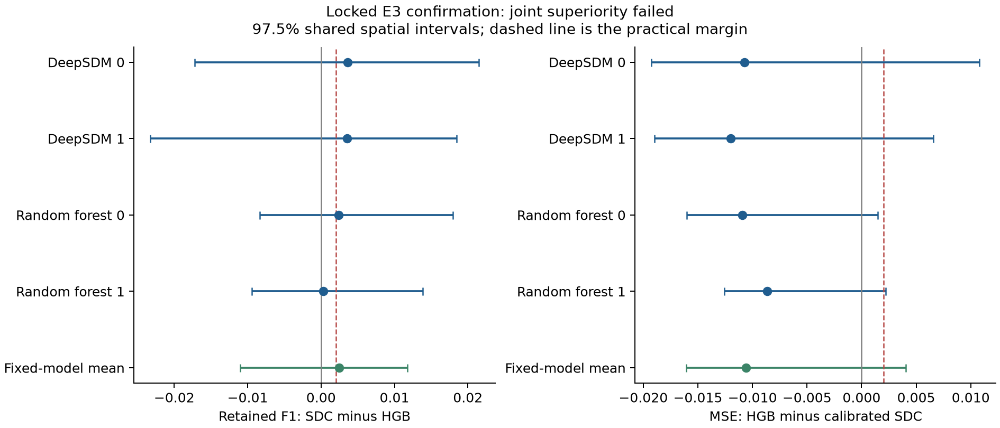
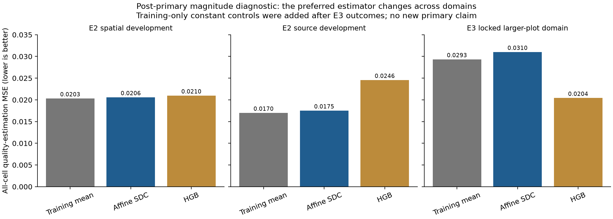

# Locked larger-plot confirmation — 16 November 2026

**E3 does not confirm joint superiority of calibrated SDC over the learned error
regressor. The MSE comparison reverses relative to E2.** A subsequent diagnostic
also shows that E2's scalar-calibration MSE result does not beat a training-mean-
only predictor. These observations require revising the paper's interpretation,
not promoting a different subgroup after inspection.

## What ran and what was held out

After E1/E2, we audited uninspected SAGE outcome rows using only covariates and
provenance. The wholly new-source subset has only three spatial blocks, mostly
Brazilian forest plots, so it cannot support broad source-population inference.
We instead locked a **larger-plot/geographic-domain** confirmation: 654 cells in
19 new five-degree blocks, six countries, with every linked plot >400 and <=10,000
m². All cells, linked plots and blocks are disjoint from E1/E2; centroids are
>=100 km from every previously consumed SAGE cell. The linked-plot audit retains
the >=500 km exclusion from GLC PA locations, uncertainty <=1 km, known non-European
provenance and sampled-area consistency. These are metadata-based checks, not
proof that every underlying contribution is fully documented.

This is a new locally locked analysis of **uninspected rows within the published
SAGE benchmark**, not a new independent data release or secret test. Some GIVD
sources overlap earlier reliability roles, and published backbone PO training
follows its original overlap protocol. Brazil supplies 363 cells in only two
blocks; source concentration limits inference.

Four fixed settings (optimized DeepSDM s0/s1 and random forest s0/s1) reuse original
E1 probability- and risk-calibration roles. We reproduce the original Platt
transforms, fit the unchanged fixed HGB loss regressor, and fit monotone-affine
SDC magnitude calibration using old riskcal only. Decoder and quota definitions
are fixed. Both magnitude estimates are clipped to [0,1] for MSE; original ordinal
scores determine acceptance. No E2 penalty choices or E3 labels tune a head.

The [protocol](confirmation_e3_protocol.md), configuration, exact cohort and code
are hashed before fitting. All four policies are frozen before the first E3
target read at **10:45:53 UTC**. The two-stage access receipts, selected sets and
exact hashes are in `results/confirmation_e3/`. All E3 outcomes are now consumed.

## Co-primary result: failed

At matched 80% country/area retention, compare SDC selection plus scalar
magnitude calibration with HGB. Require >=.002 improvement in both all-cell MSE
and retained-cell F1, positive 97.5% spatial interval lower bounds, and per-model
guards. Use 5,000 shared block resamples, averaging fixed-model contrasts.

| Endpoint, positive favors the candidate | Fixed-model average | 97.5% spatial interval |
|---|---:|---:|
| Retained F1: SDC minus HGB | +0.002471 | [-0.010984,+0.011744] |
| All-cell MSE: HGB minus calibrated SDC | **-0.010583** | [-0.016076,+0.004052] |

The F1 point margin passes but its interval does not. The MSE point difference
favors HGB in all four model settings, contrary to the candidate hypothesis;
the aggregate interval is wide and includes zero. Joint primary success is
**false**. Four model point signs are not four independent confirmations.

| Model | SDC retained F1 | HGB retained F1 | Scalar-SDC all-cell MSE | HGB all-cell MSE |
|---|---:|---:|---:|---:|
| DeepSDM 0 | 0.284529 | 0.280878 | 0.032142 | 0.021395 |
| DeepSDM 1 | 0.292367 | 0.288801 | 0.030987 | 0.018998 |
| Random forest 0 | 0.264437 | 0.262057 | 0.031700 | 0.020769 |
| Random forest 1 | 0.258918 | 0.258629 | 0.029177 | 0.020514 |



## Prespecified sensitivities do not rescue the primary

- Every E3 cell occupies the original top plot-area bin. Under the predeclared
  country × new-domain covariate-area-quintile sensitivity, average F1 gain falls
  to +.001359 and both forest settings favor HGB by their point estimates. Neither
  inference nor fine area control establishes a general selection winner.
- Clipping does not change the primary numbers; the unclipped analysis is
  identical. Empty/empty F1 versus zero-divisor-zero also changes none of the
  reported F1 values, because no E3 predicted set is empty.
- Excluding Brazil leaves 291 cells in 17 blocks. MSE still favors HGB by point
  estimate, but both endpoint intervals remain inconclusive. Brazil-only numbers
  have just two blocks; do not treat their bootstrap intervals as robust
  source-population evidence.
- Country/source/continent, rare-occurrence coverage and predictive rare recall
  remain separate descriptive outcomes. Higher retained F1 is not a conservation
  claim. These analyses were fixed before labels and cannot replace the primary.

## Post-primary diagnostic: add the training-mean control

The scalar magnitude estimator is very flat: both DeepSDM fits reach the
positive-slope floor of 1e-9. It effectively predicts the old training mean.
The training-only mean F1 is approximately .182 averaged across model settings,
whereas the new-domain mean F1 is approximately .267. HGB's mean quality estimate
is .260, versus .185 for scalar-calibrated SDC. This is an observable calibration
shift, not a causal identification of plot-area versus source effects.

We then added a **post-hoc** training-mean-only control. For E2 each outer fold
uses its own training mean, with source-exclusion probability calibration
reconstructed exactly. No evaluation outcomes fit this constant. Results:

| Study | Training-mean-only MSE | Scalar-SDC MSE | HGB MSE |
|---|---:|---:|---:|
| E2 spatial development | **0.020307** | 0.020571 | 0.020968 |
| E2 source development | **0.016988** | 0.017511 | 0.024551 |
| E3 larger-plot domain | 0.029319 | 0.031001 | **0.020419** |

Thus E2's scalar-versus-HGB improvement is not evidence of useful incremental
confidence information: the mean-only reference is better still on these points.
On E3, HGB reduces MSE by about 30.4% relative to the training-mean reference;
the scalar head is worse than that reference. These skill calculations are
descriptive diagnostics, not another successful primary test.



The exact identity `MSE = squared mean bias + prediction variance + outcome
variance - 2 covariance` reconstructs all model/domain MSEs. In E3, much of
HGB's point advantage comes from smaller mean bias and better covariance with
quality, offset partly by greater prediction variance. This decomposition is
standard algebra, not a new theorem or causal explanation. Proper matching of
point forecasts and scoring functions is established prior work
([Gneiting, 2011](https://arxiv.org/abs/0912.0902)); the mean baseline and score
skill are not claimed as our invention.

The practical lesson supported by these cases is to evaluate magnitude skill
against a training-only mean, acceptance ordering, and ecological service
separately. Do not infer transferable ranking ability from low MSE alone.
A universal superiority claim for either scalar confidence calibration or the
tested learned regressor is not supported.

## Validation, compute and GPU decision

**60 focused tests pass.** They cover outcome barriers before dataset indexing,
unconsumed identity checks, shared-model paired endpoints, ranking/scaling,
native masks, quota budgets, reproduction and MSE identity. A constant-variance
test initially compared a floating-point residual (1.9e-34) with exact zero;
its tolerance was corrected. This changes no experiment or primary implementation.
The independent validator also initially inherited the GLC CSV's `lon,lat` column
order; its distance check was corrected to explicitly select `lat,lon`. Cohort
construction already used that explicit correct order. The validated minimum
linked-plot distance to GLC PA is 710.06 km; the cohort and results are unchanged.

The final audit verifies all code/input/policy/cohort hashes, admission before
target access, native mask semantics, target coordinate/area alignment, disjoint
cell/plot/block identities, 100 exact policy settings and unchanged E1/E2 artifact
manifests. The original primary endpoint values and intervals reproduce exactly.
No historical full-suite green claim is made. Standalone PNG/PDF figures and
post-hoc source snapshots are retained.

Four old-role Platt transforms, four HGB heads and four scalar heads were fit on
CPU. There is no new neural backbone training or competition submission. E3's
scientific promotion fails, so the optional GPU head replay is not launched.
The user's continuing GPU authorization is preserved. A future independent-data
inference job can be admitted by provenance/input-contract and reference-output
tests; a neutral confirmation study must not require a favorable result before
it is allowed to run.

```bash
PYTHONPATH=src .venv/bin/python scripts/audit_confirmation_e3.py
PYTHONPATH=src:.:scripts OMP_NUM_THREADS=2 .venv/bin/python scripts/run_confirmation_e3.py fit
PYTHONPATH=src:.:scripts OMP_NUM_THREADS=2 .venv/bin/python scripts/run_confirmation_e3.py assess
PYTHONPATH=src:.:scripts OMP_NUM_THREADS=2 .venv/bin/python scripts/diagnose_confirmation_e3.py
PYTHONPATH=src:.:scripts MPLCONFIGDIR=/tmp/glc-e3-matplotlib .venv/bin/python scripts/summarize_confirmation_e3.py
PYTHONPATH=src:.:scripts OMP_NUM_THREADS=2 .venv/bin/python scripts/validate_confirmation_e3.py
```

The assessment command refuses to overwrite completed E3 results. Do not tune
and retest these rows under a new name. Use separate outputs for reproduction.

## What proceeds next

The metadata-only [NEON feasibility audit](neon_confirmation_feasibility.md) now
covers 47 official plant-survey sites and verified released neural input
configurations. Plant composition remains unopened. The next work is a concrete
plot/completeness, taxonomy and environmental-predictor bridge, followed by
reference inference tests and the authorized bounded GPU inference if they pass.
The full NEON model/data path is not ready and no NEON evaluation is claimed.

Rewrite the working manuscript around the evidence across domains, including
E3's failed confirmation and the post-hoc mean baseline. A new successful
algorithm and publication-level novelty remain unestablished. The value here
is a more demanding empirical evaluation and a falsified generalization claim,
not another apparent winner selected after testing.
