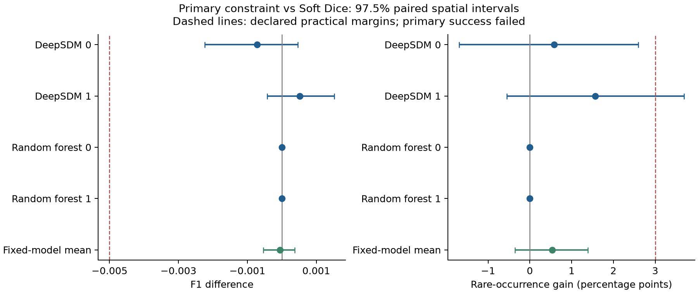

# Ecological selection pilot and locked external study — 16 November 2026

**Subsequent E2 update:** [nested ranking and source-exclusion studies](ranking_study_e2_results.md)
are now complete using calibration roles only; E1 artifacts remain unchanged.
The new monotone-affine SDC control weakens the earlier interpretation of HGB's
MSE advantage against raw 1-SDC. It has lower MSE than HGB in all four source-
study settings while preserving SDC decisions. E2 ranking corrections fail
inner admission; future GPU tests are authorized, but this candidate does not
earn scientific promotion. The paragraphs below retain E1's original evidence.

**Meaningful progress, but the proposed method did not pass external confirmation.**
We developed a predicted rare-occurrence constraint on reused GeoLifeCLEF data,
then evaluated it against published Soft Dice Confidence (SDC) under a locally
locked external protocol. The promising development gain did not transfer at
the declared practical magnitude. This is evidence against promoting this
prototype as a successful new algorithm. It also strengthens the empirical
case for testing decision alignment and ecological service explicitly.

## What actually ran

- One GeoLifeCLEF development pilot: saved ensemble predictions, two existing
  folds, 31,570 assessment surveys. No new neural training or new independent data.
- External E1: four released pretrained settings, optimized DeepSDM s0/s1 and
  random forest s0/s1. Four decoders, eight policies, four coverages: 512 table
  rows, **not 512 independent experiments**. The primary contrast was fixed in
  advance; other contrasts are secondary. Forty-eight small HGB regressors and
  four shared probability-calibration transforms were fit locally.
- One explicitly post-assessment transport diagnostic, described below; it cannot
  change the E1 policies or primary conclusion.
- **Zero new neural fits, GPU jobs or competition submissions.** Competitive
  best remains v32 private F1 0.21514; E1 scores cannot be compared with it.

The [fixed protocol](external_reliability_e1_protocol.md), configuration,
implementation snapshot, role hashes and input hashes are preserved under
`results/external_replication_e1/`. The four policies were frozen at
09:34:18 UTC, before the first assessment-target read at 09:34:24 UTC
(see the access receipt for the exact timestamp).

## Development result and rationale

At identical 80% country/area survey retention, with surrogate expected-F1
decoding, SDC attained F1 0.387576 and retained 75.09% of recorded rare occurrences.
The supervised rare-count constraint attained 0.384114 / 80.50%: +5.41 percentage
points of occurrence service at an absolute F1 cost 0.003461, and 849 versus 790
rare true positives. The raw rare-probability constraint attained
0.386082 / 78.75%, with 853 rare true positives.

These are development results; all original PA labels were historically consumed.
The supervised pilot's F1-change interval was [-0.008476, -0.001174], so even
there the point cost did not establish the later noninferiority margin.
Rarity there means training-PA frequency 1–25. External primary rarity is low
PO relative prevalence, a different operational definition. Dataset, model,
aggregation and rarity changes prevent attributing transfer failure to geography
alone. Reports: `results/ecological_selection_pilot/`.

The method starts with SDC loss ordering and exact country/area budgets, then
searches a Lagrange multiplier to retain the coverage fraction of predicted
rare-count mass. This is a standard optimization heuristic, with neither integer
optimality nor a guarantee about observed ecological coverage. Established
[SDC prior work](https://link.springer.com/article/10.1007/s10994-026-07096-w)
already defines the positive-set confidence ratio used here. Neither that ratio
nor surrogate F1 decoding is claimed as our invention.

## External data, provenance and limits

Use the public [SAGE data](https://zenodo.org/records/21297133) and
[released predictions](https://zenodo.org/records/21335338). The final cohort has
7,477 non-European 1 km cells: probability calibration 1,165; risk calibration
1,061; assessment **5,251**, across **73 assessment blocks and 32 countries**.
Calibration contained 2,540 primary rare occurrences, above the prespecified 200
minimum. Assessment contains 10,117 occurrences from the 1,155-species rare pool.
Each role occupies separate 5-degree blocks, with actual minimum inter-role
distances 50.03–50.59 km. Every method receives identical country × area budgets;
80% retention means 4,201 accepted cells in each model setting.

The prior metadata filter requires all linked contributing plots to have known
non-European provenance, be >=500 km from existing GLC PA train/test locations,
have uncertainty <=1 km and individual areas 10–400 m². It is a metadata-based
overlap audit, not proof of complete source independence. Before species outcomes,
an additional area check found that released sampled area differs from the sum
of linked plot areas for 530 candidate test cells before buffering (489 in the
initial retained cohort). Those cells were excluded and roles recomputed.
[Upstream code](https://github.com/earens/sage-sdm-benchmark/blob/main/scripts/data_prep_scripts/predictors.py)
constructs sampled effort from cleaned plots before species filtering; the
linked metadata and that effort can therefore differ. This observation does not
establish an upstream bug. Equality does not prove metadata completeness either.

Released native-range masks agree exactly with the nonmissing target entries
in all three roles. Outside-range -1 values are never absences. Canonical
species indices, target locations and sampled areas were checked. Preparation
projects only PO-based fields from species properties. Earlier schema/missingness
inspection loaded that table's columns; test-derived prevalence fields were not
used for rarity, cohort selection, policy fitting or hyperparameters. Direct
assessment PA target values stayed closed until all policies were frozen.

SAGE pretrained PO model training can include evaluation cells. The new spatial
holdout is between **our reliability-calibration and assessment roles**, not a
claim of spatially disjoint backbone training. This is a prospective analysis of
a published benchmark subset, not a secret test or a universally untouched data
source. SAGE is substantial prior work on species-level sampling-aware evaluation
([preprint](https://arxiv.org/abs/2609.31082)); our narrower focus is site-level
species-set decisions and selective service.

## Primary result: failed

Primary comparison: supervised rare-count constraint versus SDC, expected-F1
0–80 decoder, 80% retention, averaged over the four fixed model settings.

| Model | SDC F1 | Constraint F1 | SDC rare-occurrence coverage | Constraint coverage |
|---|---:|---:|---:|---:|
| DeepSDM 0 | 0.256769 | 0.256051 | 81.43% | 82.01% |
| DeepSDM 1 | 0.256845 | 0.257364 | 80.31% | 81.87% |
| Random forest 0 | 0.233233 | 0.233233 | 82.15% | 82.15% |
| Random forest 1 | 0.231300 | 0.231300 | 81.88% | 81.88% |

Shared paired spatial block bootstrap, 2,000 draws, 97.5% intervals for each
of the two primary endpoints:

- Mean F1 change **-0.000050**, interval **[-0.000542, +0.000371]**.
- Mean rare-occurrence coverage change **+0.536 percentage points**, interval
  **[-0.357, +1.388 points]**.
- The F1 noninferiority and minimum realized-coverage checks pass; the positive
  rare-service improvement and >=3-point practical-gain checks fail. Even the
  upper interval endpoint is below the planned three-point gain for this fixed
  contrast. Do not describe failure as merely an insufficient number of seeds.

The raw rare-mass constraint is inactive for all four settings at the primary
coverage: SDC already retains 82.1–83.9% of its predicted rare mass. The supervised
constraint changes DeepSDM policies but is inactive for both forest policies.
This explains the many identical cells in the table. It does not establish a
universal reason for all possible ecological constraints to fail.



## Prespecified secondary findings: descriptive

At the same primary decoder and coverage, averaged over four fixed settings:

| Contrast | F1 change | Descriptive 95% spatial interval |
|---|---:|---:|
| SDC minus matched random | +0.009627 | [+0.007059, +0.012641] |
| Learned risk minus SDC | -0.004175 | [-0.006998, -0.001686] |
| Predicted-set entropy minus matched random | -0.008228 | [-0.010828, -0.005150] |
| SDC minus mean confidence | +0.000350 | [-0.000381, +0.001219] |

Learned risk loses to SDC in all four settings. Entropy loses to random in all
four settings and the average contrast is negative for all four decoders.
The learned-versus-SDC average is also negative for all decoders. This replicates
an operational failure mode seen during GLC development; it does not establish
that all entropy measures or all learned uncertainty methods fail.

At full coverage, surrogate expected-F1 0–80 improves F1 over top-18 in every
setting: 0.217982→0.246297, 0.220257→0.246709,
0.200821→0.225040 and 0.199222→0.224026. This uses the same calibrated probabilities
and fixed ordering, so it is a decision-rule effect. The 0–80 extension is a
secondary analysis, not a newly invented F-measure optimizer. Empty predictions
are uncommon (0.04–0.15% at full coverage), versus 2.13% observed empty cells;
the gain cannot be interpreted as simply earning empty/empty points. Both F1
conventions are in the tables.

The total-richness constraint shows only +0.551 points of rare-occurrence service
and +0.000111 F1 versus SDC, descriptively. It cannot rescue the failed primary
or be promoted after inspecting these outcomes. Country, continent and source
tables expose local heterogeneity; rare precision/recall, true positives and
secondary rarity are included. Small source/country cells are not robust subgroup
evidence. Additional secondaries have no multiplicity-adjusted success claim.

An elementary mechanism helps interpret predicted-set entropy: binary entropy
rises with p on (0,.5), whereas the confidence appropriate for predicting presence
rises with p. Low entropy can mean confident absence inside a set declared present.
The median mean selected probability is only 0.154–0.159 in these settings.
This is a mathematical explanation to investigate, not a new theorem or proof
that this mechanism alone caused the measured differences.

## Post-assessment transport diagnostic: completed

Using unchanged features and hyperparameters, five-fold GroupKFold over the 30
risk-calibration spatial blocks tested the error regressor without relying on
its training predictions. All four full-data diagnostic refits reproduced the
original frozen assessment selections exactly. There were 24 small diagnostic
HGB fits, zero neural fits, and no change to E1's outcome.

Training loss-rank correlations were 0.648–0.666; spatial out-of-fold correlations
fell to **-0.059 to +0.053**. The weakness was already visible inside calibration;
it should not be presented as an assessment-only surprise. On assessment,
HGB improved squared error relative to the **raw** 1-SDC loss estimate in all
four models (MSE 0.0191–0.0244 versus 0.0236–0.0253), while quota-constrained F1
selection was worse in all four. This distinguishes estimating error magnitude
from ordering decisions within operational groups. A calibrated SDC MSE baseline
was not tested, and this diagnostic is not a new primary claim.

The next mechanism to investigate is calibration-only **ranking and selection
utility**, with SDC as the required comparator and geographically held-out inner
folds. Optimizing squared error or plotting in-sample risk fit is inadequate
admission evidence. A different objective still has to earn practical improvement;
this does not prove that a ranking-loss method will succeed.

## Reproducibility and integrity

Commands use the repository Python 3.12 environment with supplemental versions
in `configs/external_reliability_e1_environment.txt`. Inputs are ignored under
`data/external_replication_e1/`; baseline predictions total 2,745,286,926 bytes.
Public TAR members were range/header checked and locally SHA256 hashed. Source
archive MD5 values are recorded but whole TAR MD5s were not recomputed. The
standalone target file's published MD5 is verified. Credentials are not needed.

```bash
PYTHONPATH=src .venv/bin/python scripts/prepare_external_e1.py
PYTHONPATH=src OMP_NUM_THREADS=2 .venv/bin/python scripts/run_external_e1.py fit
PYTHONPATH=src OMP_NUM_THREADS=2 .venv/bin/python scripts/run_external_e1.py assess
PYTHONPATH=src:.:scripts MPLCONFIGDIR=/tmp/glc-e1-matplotlib .venv/bin/python scripts/summarize_external_e1.py
PYTHONPATH=src:.:scripts OMP_NUM_THREADS=2 .venv/bin/python scripts/diagnose_external_e1_transport.py
```

The recorded run refuses refitting after evaluation admission. For a clean rerun,
use a separate copy/output directory and preserve the existing lock and receipts.
Retrieval entry point is `scripts/retrieve_sage_e1.py`, using the audited TAR
indexes and immutable Zenodo-record metadata. Metadata/targets must be retrieved
before preparation; prediction members before fitting. Exact consumed input
hashes are in `protocol_freeze.json`.

After assessment, JSON serialization of a NumPy boolean failed. An explicit
`serialization_amendment.json` preserves before/after source hashes and the
original snapshot; the repair adds Python-scalar conversion and validates the
amendment. A second output path (stdout) needed the same conversion. No policy,
metric, threshold or inferential choice changed. **Both summary CSVs are
byte-identical before and after correction.** The completed runner exits zero.
Focused validation: **39 passed**, including assessment-read exclusion, native
mask semantics, empty decisions, quota/permutation invariance and shared-model
bootstrap checks. This is not a historical full-suite green claim.

## Paper implications and next work

The thesis now has a real external, model-family replication with a transparently
failed methodological hypothesis. A strong new-method paper is not established.
A narrower empirical paper could study why decoder-aware confidence, geographic
budgets and ecological service lead to different conclusions across SDM settings.
Its novelty must be assessed against SDC and SAGE, not inferred from these numbers.

Do not launch the earlier 18+6 neural-fit budget automatically. The transport
diagnostic is complete. Next finish a focused related-work/claim matrix; draft the
methods/results with failures intact. Any new algorithm should be developed on
already consumed/calibration data, with spatial inner validation and a fixed
SDC comparator. Require a concrete mechanism and practical gain before one new
locked source/domain confirmation. These E1 outcomes are now consumed; renaming
splits or retuning the proxy does not create another independent confirmation.
