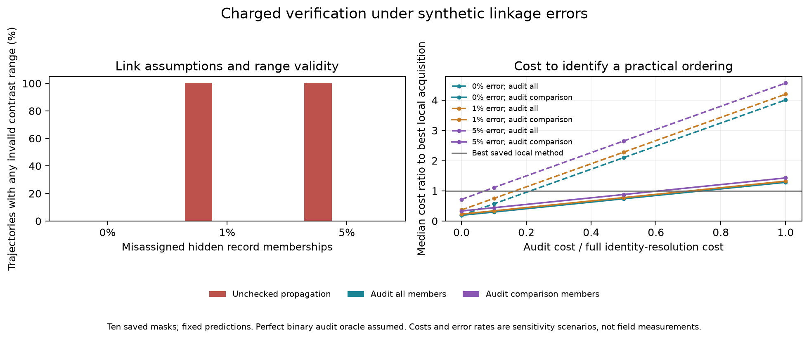

# T3: valid comparisons require charged, trustworthy verification

Completed 21 November 2026. **The reference robustness criterion fails.** The
candidate improves over the strongest matched shared-query control by **9.34%
at 1% error and 7.71% at 5% error**, below the declared 10% mean-cost target.
All ten masks favor it on those comparisons, but that does not replace the
missed practical threshold. T2's earlier failed primary and secondary labels
are unchanged.

The stronger result concerns assumptions and cost: unchecked propagation can
produce invalid comparison ranges despite a correct point ordering, while
explicit verification restores validity under an ideal audit oracle. Whether
sharing saves cost then depends strongly on the audit price and which records
are verified. These are controlled benchmark findings, not measured field time
or a new general algorithm.

## Executed experiment and invariant information

The [protocol](linkage_robustness_t3_protocol.md), code and input hashes freeze
before the main replay. Construction-only feasibility checks inspect error
generation, not new F1/policy outcomes. All labels and model outputs are already
consumed. Reuse the same **5,251 cells, 73 blocks, 32 countries**, target/native
universe, predictions and 4,201-cell-per-policy acceptance sets as T2.

Ten masks × three membership-error doses × three information procedures × four
acquisition orders produce **360 CPU trajectories / 2,520 checkpoints**. Four
normalized audit prices generate **1,440 cost evaluations** from those paths.
Main replay time is **536.05 seconds**, excluding tests/preparation/validation.
There are zero new model/head/calibration fits, inference or GPU jobs, field
composition downloads and competition submissions.

Swap hidden record memberships only within the original block and public genus,
between groups with different target-label categories. Each group retains an
original member; no duplicate cell is introduced. Every cell's hidden genus/
target-label-category multiset and initial known labels stay identical. Error
doses are nested prefixes. Integer rounding makes realized nominal 1% rates
.9957–.9994%, and nominal 5% rates 4.9958–5.0000%; every planned dose is feasible.
The generator is deliberately label-informative stress, not an empirical NEON
error mechanism. Outside-target species are one cached category, so this does
not model every botanical identity error or wrong genus.

## Verification and cost contract

Unchecked propagation identifies one representative and assigns its target label
to every proposed member. Audit-all identifies the representative, checks every
follower for target-label compatibility, and pays for a full identification on
each mismatch. Audit-support applies that procedure only to publicly determined
members relevant to the fixed contrast and keeps other records unresolved.

The compatibility audit is **perfect by assumption**, supplies only a binary
answer and is charged separately from full identification. Its price ratios
0/.1/.5/1 are sensitivity scenarios. No observed botanical accuracy, monetary
price or measured taxonomist time is established. One group is an atomic action.
Total cost is `full identifications + audit_price × follower audits`.

Each procedure chooses its smallest-row representative among the members it
examines. Scope and representative choice therefore change together between
audit-all and audit-support; the experiment does not isolate their individual
effects. It does match scope, information and charging across acquisition
strategies within the primary audit-support comparison.

## Range validity: correct ordering can hide incorrect labels

| Nominal error | Unchecked trajectories with any contrast failure | Unchecked failing checkpoints | Maximum incorrect known labels in a checkpoint | Guarded contrast/known-label failures |
|---|---:|---:|---:|---:|
| 0% | 0 / 40 | 0 / 280 | 0 | 0 |
| 1% | **40 / 40** | **80 / 280** | 1,625 | 0 |
| 5% | **40 / 40** | **82 / 280** | 4,340 | 0 |

Across nonzero error doses, **162 unchecked checkpoint ranges exclude the true
finite-cohort contrast**. At 5% error, 5/40 unchecked trajectories already exclude
it at their first practical-sign stopping point. Nevertheless, **no wrong
practical ordering is observed in this cohort**. Do not turn range invalidity
into an unsupported claim that tested policy rankings reverse. A correct sign
can coexist with incorrect known labels and an invalid advertised range.

Both audited procedures have zero incorrect known labels, cell-level oracle
exclusions, contrast exclusions and wrong signs at their checkpoints/stopping
points. This is conditional validity under perfect audits, correct public genera
and complete recorded benchmark inventories. It is not a probabilistic field
guarantee or evidence that a real audit has zero errors.

## Reference criterion at audit price .1

The primary compares mean cost to identify an ordering beyond .001 F1. Require
>=10% reduction versus every matched audit-support acquisition control and the
best saved local method, in >=8/10 masks, at BOTH nonzero error doses. The local
reference includes paired width and is the minimum of all five saved T2 methods
per mask; paired width is in fact the best local method in every mask.

| Audit-support acquisition | Mean cost, 1% error | Mean cost, 5% error |
|---|---:|---:|
| Support-uniform | 2,388.17 | 2,812.76 |
| Support-incidence | 2,032.72 | 2,502.56 |
| Global width, restricted to the same public scope | 1,521.15 | 1,942.44 |
| Paired width | **1,379.06** | **1,792.69** |
| Best saved local acquisition | 4,094.70 | 4,094.70 |

Paired acquisition saves 42.3%/36.3% against support-uniform and 32.2%/28.4%
against incidence, but only **9.34%/7.71% against the strongest global-width
control**. Mean paired savings against that control are 142.09 and 149.75
cost units, with descriptive mask-bootstrap intervals [123.55,162.62] and
[130.55,174.38]. The criterion fails; no budget, threshold or comparator is
changed after seeing this result.

At this assumed price, audited shared paired acquisition costs **66.3% / 56.2%
less on average than the best local reference**. This supports a conditional
sharing/verification lead, while narrowing the incremental acquisition-method
claim. The 10 masks are Monte Carlo repetitions on one fixed cohort/model;
bootstrap intervals do not measure ecological-population or model uncertainty.

## Price frontiers and verification scope

Median costs to identify a practical ordering, using paired acquisition:

| Nominal error | Audit-all, price .1 | Audit-support, price .1 | Best local | Audit-all, price 1 | Audit-support, price 1 |
|---|---:|---:|---:|---:|---:|
| 0% | 2,330.45 | 1,215.20 | 4,071 | 16,359.50 | 5,250.50 |
| 1% | 3,085.00 | 1,382.50 | 4,071 | 17,075.50 | 5,411.50 |
| 5% | **4,519.70** | **1,786.60** | **4,071** | 18,599.00 | 5,795.50 |

At 5% error and price .1, checking all linked members is already more costly than
the best local reference, while comparison-focused checking remains cheaper.
At price 1, both shared procedures are more costly. No universal shared-query
advantage follows from fewer concept queries.

For each fixed stopping prefix, cost is linear in audit price. Median break-even
prices against the best local reference are:

| Nominal error | Audit-all | Audit-support |
|---|---:|---:|
| 0% | .213 | .742 |
| 1% | .166 | .708 |
| 5% | .072 | .611 |

These are per-mask threshold summaries for fixed batch orders, not measured
operational prices or globally optimal frontiers. At 5% error, individual
audit-support thresholds span .587–.661. Prices beyond those thresholds remove
the sharing advantage for those masks. Acquisition itself is not price-adaptive.

Comparison-focused checking also leaves broader inventories incomplete: at the
25% group budget and 5% error, paired audit-all reaches mean known-label fraction
.9915 and 24.3 affected countries, versus .9656 and 22.5 for audit-support. These
are different charged procedures; the group-budget comparison is not a matched-
total-cost conservation experiment. No ecological benefit or harm is inferred.

## Validation, integrity and limits

**417 full local tests pass**, zero failures/errors/skips, in 278.84 seconds with
three upstream warnings. The overlapping focused set has 20 tests, ten new for
T3. Exhaustive tiny target-category cases check guarded bounds at every group
prefix, along with outside-target handling, overlap, cost charging, empty scope,
duplicate charges and inventory-preserving nested corruption.

Independent dense reconstruction verifies **108 checkpoints**, **240 primary
stopping-boundary prefixes**, **720 operation-cost endpoints**, **12 acquisition
orders** and all 360 order hashes. It recomputes the reference criterion and
inventory invariants. Final integrity checks additionally verify every dose,
same-block/genus membership, unique cells, retained original members and nested
error masks across all 30 cases. Clean all-audit/unchecked stopping prefixes
reproduce T2 for every mask/control.

All prior manifests remain unchanged. The original renderer/source and initial
PNG/PDF are preserved; a separately saved presentation-only renderer moves the
legend for the final inspected figure without changing results. Scientific
code, protocols/results and compact artifacts are public; private record answers,
working caches, credentials and agent notes remain local and ignored.

The paper lead is a measured distinction between valid comparison, record-link
assumptions, acquisition ranking and verification scope/cost. Perfect audits,
correct genera, one collapsed outside category, complete benchmark inventories,
one backbone/cohort and reused outcomes remain important limits. Active vetting,
paired active comparison and linkage-error propagation already have prior art;
neither a general new method nor field annotation savings is established.

Next is the remaining stronger-baseline package: matched adaptive/cost-aware
comparators and targeted ablations, before expanding a method claim. Then assess
model/source replication and separately uninspected confirmation. Keep T2/T3
failed criteria intact. See [the overall thesis/paper status](thesis_paper_status.md).
