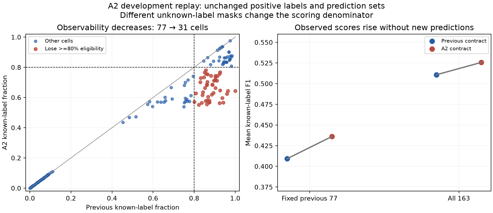

# A2/A3: current-record provenance and exact synonym corrections

Completed A2/A3 on 17 November; uncertainty guard A3u on 19 November 2026.
**The observation contract is better audited; the
field confirmation is still not admitted.** No model, prediction set, confidence
score, class universe or calibration parameter changes. A2 audits selected
records/history and stricter uncertainty handling. A3 adds explicit accepted-
species aliases. A3u preserves that mapping and expands alias uncertainty masks.
All use the consumed E4 cohort and are development replays.
The original E4 primary and earlier post-hoc results remain unchanged.

## What was executed

The [A2 protocol](neon_taxonomy_a2_protocol.md) is locally frozen at
**09:40:04 UTC**, before this run retrieves selected rows. It verifies published
size/MD5 identities, decodes only the original 301 plots/bouts at 163 cells,
and caches selected fields locally. The previous morphospecies labels reproduce
**bit for bit** before any change. All 389 selected morphospecies keys give the
same 349 dated / 40 undated resolution counts as the earlier replay.

The 55,380 selected rows include 45,750 plant records before strict conflict
handling. There are **six linked observation-history keys and six matching
archived records**. Their past IDs differ from current IDs, but no archived
identity replaces a current label. All six currently have public named ranks;
the higher-rank metadata-only guard remains tested and is not exercised by
these six keys. No selected plot has multiple event IDs. This does not prove
complete detection or resolve every current taxonomic concept.

All **1,610 selected infraspecific current records** remain lexical-parent
candidates requiring validation. None supplies an explicit accepted-species
resolution under A2's rule. A1's 9,047 explicit accepted-species links were
dictionary counts; they do not imply many such links occur in this cohort.
History therefore supplies no large reserve of extra identifiable labels here.

The current/history and join roles follow the official
[NEON quick-start guide](https://data.neonscience.org/api/v0/documents/quick-start-guides/NEON.QSG.DP1.10058.001v2?fallback=html&inline=true)
and [RELEASE-2026 documentation](https://data.neonscience.org/data-products/DP1.10058.001/RELEASE-2026).
No staff identifiers, free-text notes, unselected taxa or protected higher-rank
identities are reverse-resolved.

## A2: less observability can raise observed F1

A2 propagates uncertainty through the full accepted-name chain. When a genus
has no modeled members, it falls back to compatible family/classes rather than
interpreting the empty genus match as proof of an outside-target observation.
It also retains conflicting current concepts and quality/rank mismatches as
unknown. Unmatched names remain unresolved, not certified absences.

Relative to the previous morphospecies contract, A2 adds **6,782 unknown class
pairs**, with **zero added or removed confirmed positives**. The >=80%-known
subset shrinks from **77 cells / 11 sites to 31 / 6**. Median class-known
fraction falls .768018 → .574324.

On the **same previous 77 cells and unchanged prediction sets**, mean known-label
F1 rises **.409282 → .436122 (+.026839)**. A2 removes 234 previously scored
negative predictions from this subset's scoring denominator (262 across all
163 cells). No new predictive accuracy was achieved: the observed-label target
changed. There is no complete-field oracle with which to estimate bias.

A separately labeled **post-hoc 2×2×2 component ablation** reports all eight
combinations of current-record rules, uncertainty masks and accepted mapping.
All four legacy-mask arms admit 77 cells; all four full-chain/fallback-mask arms
admit 31. Thus the mask component causes this implementation-level attrition;
neither the six history records nor a model change explains it. These are
component controls, not eight independent ecological datasets or model fits.
No arm is selected for favorable F1.

## A3: exact accepted-species aliases recover real modeled presences

A2's post-hoc metadata screen identifies current names that share an explicit
accepted-species concept with one model-class alias. The [separate A3 protocol](neon_taxonomy_a3_protocol.md)
locks an extension before new labels/scoring. It retains existing exact class-
name matches, requires uniqueness over **all 5,771 model classes before native
filtering**, and rejects multiple aliases, higher ranks and unsupported parents.
It does not merge class ontologies or claim independent taxonomic authority.

A3 adds **553 dictionary links**. In selected records, 736 clean alias matches
include 556 inside the fixed eligible subset and 180 outside it; 31 qualified
matches remain uncertain. Duplicate subplot records are not independent taxa.
The extension recovers **123 distinct modeled native cell–species presences**,
raises known class pairs by **1,740**, and removes no existing positive labels.
Median known fraction improves to **.619369**, and eligibility becomes **34 cells
/ six sites**. This still falls far below the historical 100-cell/12-site rule.

No field-positive-genus constraint, lexical parent or historical replacement is
used. Existing exact class-name matches retain their nominal target semantics;
this does not establish that the model and NEON have identical biological
taxonomic concepts in every case.

## Original A3 utility, preserved before the mask guard

These cohorts have different observability and must not be compared as if a
model improved between them. Within each cohort, all methods use identical 80%
site × single/multiple-plot-cell quotas. Intervals are descriptive 97.5% paired
site-bootstrap intervals, conditional on the fixed policies and consumed cells.

| Cohort | Cells / sites | A2 known F1 | A3 known F1 | A3 HGB − SDC selective F1 | 97.5% site interval |
|---|---:|---:|---:|---:|---|
| Original fixed E4 subset | 65 / 10 | .452603 | .457631 | +.009334 | [−.012793,+.034561] |
| Previous fixed morphospecies subset | 77 / 11 | .436122 | .442888 | +.003673 | [−.021120,+.027439] |
| All candidate cells | 163 / 16 | .525700 | .533082 | −.003514 | [−.013345,+.006493] |
| Fixed A2-admitted subset | 31 / 6 | .408426 | .410256 | +.001659 | [−.019637,+.013940] |
| A3 >=80%-known subset | 34 / 6 | .405047 | .407737 | +.002855 | [−.018001,+.014978] |

All selector intervals span zero. On the A3-admitted 34 cells, HGB MSE is
**.088203**, versus training mean **.051227**, affine SDC .062503 and raw SDC
.061370. The observed-label mean-minus-HGB MSE gain is −.036976, descriptive
site interval [−.081434,−.010479]. This remains a comparison of observed-label
targets, not a universal transport law or population result from six sites.

Full-set completion uncertainty remains substantial: mean F1 width is **.290786**
on those 34 cells; HGB-minus-SDC can range **[−.062228,+.053932]**. On the fixed
previous 77 cells, the range is [−.094719,+.092480]. These are identification
ranges, not CIs or a new theorem. They do not use the T1 simulator's unavailable
positive-genus assumptions. All 163 cells having enough sites by count does not
mean they meet the >=80% observability rule.

## A3u: separately preserved alias-mask correctness guard

A final support check finds seven uncertain mapped-record candidates outside
their individual literal-genus masks. Other uncertainty or confirmed positives
already cover those particular candidates in this cohort; the check alone
identifies no retained confident absence. It exposes a rule that also needs to
cover unresolved higher-rank genera: a possible species can use another genus
in the model's synonym vocabulary. A3's original source, labels and results
remain preserved, including the table above.

The [A3u protocol](neon_taxonomy_a3u_protocol.md) freezes a conservative overlay
before the guarded replay on 19 November. It unions the original mask with
model aliases linked through explicit accepted-species concepts for the same
public genus, or family when no genus is available. It includes a named record's
mapped candidate, never narrows the old uncertainty mask and never identifies
a higher-rank record merely because a candidate is unique. Existing confident
positive witnesses still override uncertainty. This is a correctness repair,
not another search for a favorable F1 or an independently validated field oracle.

Relative to original A3, the overlay marks **199 additional cell–class pairs
unknown**. All **4,284 positive pairs**, including the **123 recovered presences**,
are unchanged. Relative to A2, 1,674 pairs become known and 133 become unknown
(net +1,541). Median class-known fraction remains .619369. The final >=80%-known
subset is **33 cells / six sites**, below the 100/12 requirement. No model fit,
GPU job, new composition request or parameter selection occurs.

| Fixed cohort / rule | Cells / sites | A3u known F1 | HGB − SDC selective F1 | 97.5% site interval |
|---|---:|---:|---:|---|
| Original E4 subset | 65 / 10 | .458676 | +.009670 | [−.012374,+.034632] |
| Previous morphospecies subset | 77 / 11 | .443770 | +.003955 | [−.020387,+.027626] |
| All candidate cells | 163 / 16 | .533565 | −.003472 | [−.013359,+.006615] |
| Fixed A2 subset | 31 / 6 | .411258 | +.002504 | [−.017057,+.013940] |
| A3u >=80%-known subset | 33 / 6 | .404717 | +.002319 | [−.015017,+.013260] |

On the final 33 cells, HGB quality MSE is **.088485**, versus training mean
**.050904**, affine SDC .060106 and raw SDC .058214. Mean-minus-HGB MSE gain is
−.037581, with descriptive interval [−.082195,−.009818]. Mean full-set F1
identification width is .290534; the HGB-minus-SDC contrast range
**[−.066710,+.061867]** spans both signs. On the fixed prior 77 cells, the range
is [−.095553,+.093787]. Changing cohort and target observability changes these
numbers; none establishes predictive improvement or rescues E4.

## Validation, interpretation and next contribution

A2 has 30 focused tests; A3's focused set has 26 tests. Independent validation
recomputes all 163-cell confusion scores and completion endpoints, reproduces
20 A2 and 25 A3 selector rankings/budgets, checks selected scope/history guards,
and requires current-record witnesses for every positive. All 553 added alias
links independently match a unique accepted-species group. A2 witnesses 4,161
cell–species positives; A3 witnesses 4,284. Chronology, input identities and old
replay equality pass. A3u adds four regression tests (21 tests in its overlapping
focused set). Its independent support check covers 24,040 uncertain records and
25,286 eligible cell–class alias possibilities, with zero supported uncertain
aliases scored as confident absences. It verifies unchanged positive witnesses,
mask expansion, all 163 confusion/bound rows and 25 selector rankings/budgets.
The standalone A2 figure is visually inspected. The full suite passes **397 tests** (zero failures/errors/skips), recorded in
[the release validation](taxonomy_audits_validation_2026_11_19.md).

This is meaningful evidence for the measurement/decision-evaluation paper:
reported F1 can rise when observability falls, even with fixed cells, fixed
predictions and unchanged confirmed positives; justified name harmonization can
then add genuinely supported labels. The first statement is standard score
algebra quantified here, not a new theory. The second is established taxonomic
curation, not a new algorithm. No new-method success, biological species
discovery, intrinsic NEON inadequacy or independent confirmation is claimed.

The next experiment should address **verification cost and identifiable paired
utility**, using a fully recorded-label benchmark oracle, realistic shared
taxon-concept query units, an outside-target option and strong matched controls.
It should not depend on resolving every NEON name or on another neural sweep.
Additional botanical parent validation remains a bounded field-contract task;
it is not permission to invent missing absences or rescue E4.

Results/caches are separate under `results/neon_taxonomy_a2/`,
`results/neon_taxonomy_a3/`, `results/neon_taxonomy_a3u/` and ignored corresponding
`data/` folders. A3u is the current guarded contract; earlier stages are retained
for audit and must not silently replace the original E4 primary.
