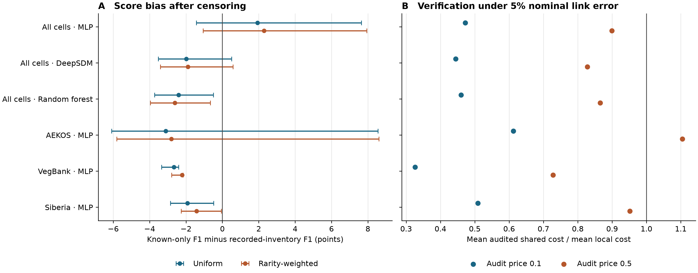

# T5 results — model and survey-contributor replication

T5 reuses the 5,251 SAGE E1 assessment cells and verified saved predictions
from an aggregation MLP, DeepSDM and random forest. The two additional
prediction settings reproduce the original E1 ranks and decoder counts exactly
under E1's original native masks. Within the study, all models use the T1
target universe and score on identical labels and masks. The MLP's fixed
HGB/SDC policies are held constant across models. Within each contributor the
same quota rule is reapplied to the frozen policy scores.

| SAGE cohort view | Cells | 5-degree blocks | Cells accepted per policy | Disagreement cells |
|---|---:|---:|---:|---:|
| Full E1 assessment | 5,251 | 73 | 4,201 | 1,440 |
| AEKOS (AU-AU-002) | 1,469 | 9 | 1,176 | 468 |
| VegBank (NA-US-002) | 939 | 10 | 752 | 238 |
| Siberia (AS-RU-002) | 567 | 15 | 454 | 194 |

The three single-source groups are survey contributors to the SAGE benchmark.
Their scores reflect each contributor's geography and plot design. The full
cohort overlaps the contributor views. These are consumed-record results.

## A. Score bias changes direction across models

At nominal 20% genus censoring, **98.08–98.24%** of eligible label pairs
remain known on the pooled cohort, while **26.02–26.14%** of the recorded
positives are hidden. These are pooled counts across eligible pairs and
positive occurrences. The direction of known-only F1 error varies with the
prediction set and the treatment of empty inventories.

| Prediction setting, all cells | Uniform, empty=1 | Rarity-weighted, empty=1 | Uniform, empty=0 | Rarity-weighted, empty=0 |
|---|---:|---:|---:|---:|
| MLP | +.0194 | +.0230 | −.0317 | −.0281 |
| DeepSDM | −.0198 | −.0189 | −.0385 | −.0376 |
| Random forest | −.0240 | −.0261 | −.0362 | −.0382 |

With empty/empty=1 the same censoring yields, on average, 268, 98 and 64
apparent perfect scores on nonempty recorded inventories for MLP, DeepSDM
and RF. Known-only F1 declines on all three contributor subsets for all
three models at the moderate dose. Descriptive 97.5% paired block-bootstrap
intervals are wide for several effects. For example, the full-cohort MLP's
uniform-mask interval is [−.0144, +.0765], and the random forest's is
[−.0373, −.0049]. Group-level effects and intervals are available for every
mechanism, dose, prediction model and convention.

At the moderate dose, the primary known-only score reverses a model ordering
in one model-pair/contributor/mechanism combination. Under the rarity-weighted
mechanism, DeepSDM leads MLP on the recorded VegBank inventory by **.002144**.
The censored scores favor the MLP by **.000199–.003842** in **10/10** masks.
The .002 screening threshold applies to the full recorded difference. In
some masks the reversed point gap is smaller than .002. None of the fixed
HGB–SDC policy pairs reverses at the moderate dose. The exploratory
[T6 shared-inventory analysis](paired_completion_t6_results.md) finds both
model orderings feasible under unresolved labels in all ten VegBank masks.

[Protocol](observation_replication_t5_protocol.md) ·
[Mask-level scores](../results/observation_replication_t5/score_masks.csv) ·
[Spatial intervals](../results/observation_replication_t5/score_intervals.csv) ·
[Model orderings](../results/observation_replication_t5/model_ordering.csv)

## B. Charged cost and range validity transport conditionally

The replay executed **480 audited shared trajectories, 48 local trajectories,
and 48 unchecked paths**, plus **96 price-only reuses**. All guarded shared
and local paths reach the .002-width endpoint and the secondary practical sign
endpoint. For the table, use static scope width and equally scoped perfect
audits, with the best of the two local width orders per mask as reference.
Entries show mean paired cost savings over four masks at the same .002 target
width. A negative saving is a cost increase.

| Cohort and predictions | 1% error, price .1 | 1% error, price .5 | 5% error, price .1 | 5% error, price .5 |
|---|---:|---:|---:|---:|
| Full · MLP | 61.7% | 19.0% | 52.8% | 10.0% |
| Full · DeepSDM | 63.5% | 25.1% | 55.6% | 17.2% |
| Full · random forest | 62.6% | 22.0% | 54.0% | 13.4% |
| AEKOS · MLP | 46.5% | −2.9% | 38.6% | −10.7% |
| VegBank · MLP | 73.7% | 33.4% | 67.2% | 27.0% |
| Siberia · MLP | 55.7% | 11.4% | 49.1% | 4.8% |

The nominal error uses within-block, within-genus identity swaps. Every
construction preserved the cell-level hidden record inventory and initial
known labels. One AEKOS mask reached **4.61%** at the nominal 5% target. The
remaining cases made all requested swaps subject to integer rounding. Under
unchecked propagation, **all 48 paths** exclude the reference contrast at
least once (**79 of 240 checkpoints**). No checkpoint has a wrong practical
sign. Guarded ranges contain the benchmark F1 at every validated endpoint and
recover no incorrect known labels under the perfect-audit assumption.

Adaptive width reduces mean paired cost relative to static width in every
model/source/error/price stratum, with changes of about **1.7–11.3%** across
strata. The learned forecast changes mean paired cost by **−0.47% to +0.64%**
relative to the fixed forecast with all other settings held constant. This
supports a conditional effect of updated widths and gives little evidence for
learning the mismatch forecast. Costs are simulated units. Contributor
differences confound geography, survey design and the pattern of policy
disagreement. The four masks quantify sensitivity to simulated missingness.



Panel A shows descriptive paired spatial intervals. Panel B shows ratios of
mean costs under the same .002-width endpoint. Panel B therefore uses a ratio
of means, while the table reports the mean of paired savings.

Validation independently reconstructs **1,056 charged-operation endpoints
and 528 dense stopping prefixes**. All 96 matched reference paths reproduce
the saved T4 MLP costs at both endpoints. The batch replay used 515.7 seconds
on CPU plus 63.8 seconds for scoring. There were zero fits, new inference
runs or GPU jobs. The full pre-existing suite passes 426 tests, and the two
separate T6 exhaustive tests pass. All earlier T4 and historical manifests
were reverified. The sources and input hashes freeze before their respective
replays. A presentation-only lock-reader correction was needed in the
post-run summary script. The computation and frozen endpoints are preserved.

[All controls and outcomes](../results/observation_replication_t5/verification_summary.csv) ·
[Operation counts and endpoints](../results/observation_replication_t5/verification_endpoints.csv) ·
[Unchecked checkpoints](../results/observation_replication_t5/unchecked_checkpoints.csv) ·
[Corruption receipts](../results/observation_replication_t5/corruption_receipts.csv).

From the repo with the original local inputs restored:

```bash
.venv/bin/python scripts/verify_observation_replication.py
```
