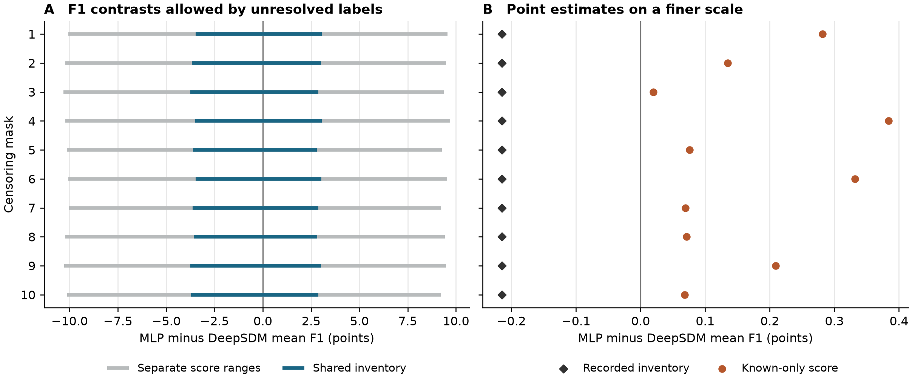

# T6 results — paired model comparison with unresolved species labels

Completed 22 November 2026 as an exploratory follow-up to T5. On the same
recorded inventories and censoring masks, giving both models a common label
completion reduced the mean F1 contrast range width from **.2175 to .0885**
(**59.3% narrower**). The paired bounds identified an ordering beyond .001
in **80 of 240 cases**, versus **0 of 240** for the difference of separate
per-model bounds. Both contained the recorded benchmark contrast in every case.

The 240 cases combine three model pairs, four cohort views, two missingness
mechanisms and ten mask seeds at nominal 20% censoring. Each row scores the mean
of per-cell set F1 values with empty/empty=1. The 20 cases for each identified
model-pair/cohort combination all agree in sign. On all 5,251 cells the MLP
outranks both other settings. In the Siberia contributor, DeepSDM outranks both.
Neither the AEKOS nor VegBank comparisons clear the margin under all
completions. Repetitions and overlapping cohort views describe this simulation
on a fixed benchmark.

The VegBank MLP–DeepSDM contrast provides a compact example. With rarity-weighted
missingness, known-only F1 ranks the MLP higher in all ten masks. The full
recorded labels rank DeepSDM higher by .002144. Both signs remain possible in
every paired completion range for these ten masks. Thus the fixed model
predictions support the opposite observed ranking solely through the scoring
contract, while the more informative range still signals uncertainty.

## Interpretation

Subtracting independent score bounds allows each model to be scored against a
different invented inventory. Shared completion evaluates both under the same
unknown labels. For each cell and possible count of additional positives, the
F1 denominators are fixed. Maximizing and minimizing the difference then
allocates positives among shared, A-only, B-only and neither predicted
classes. The per-cell extrema aggregate exactly when completions are
unrestricted across cells. The two exhaustive tiny-case tests cover both
empty conventions. The complete replay checks cellwise nesting in the separate
bounds and containment of the recorded difference.

Fernández-Barrios et al. already study exact shared-completion bounds for binary
F1 after labeling disagreements. T6 uses paired mean per-cell species-set F1
with arbitrary unresolved species in each cell. This is an ecological application
and empirical comparison of information models. The broader shared-completion
principle and partial-identification approach have prior art.
[Fernández-Barrios et al. (2026)](https://arxiv.org/abs/2611.01712),
[Polo et al. (2024)](https://papers.neurips.cc/paper_files/paper/2024/hash/f4c6bec746b0aeca8c2cd15096f1ad1f-Abstract-Conference.html).

The feasible inventories assume correct known labels and binary completion
within the eligible class universe. They impose neither shared species keys
across cells nor genus occurrence counts. Range width and sign concern the
evaluated cohort. T6 supplies no population confidence interval or field
confirmation and uses no new model fits or inference.

[Protocol](paired_completion_t6_protocol.md) ·
[Per-case endpoints](../results/paired_completion_t6/endpoints.csv) ·
[Summary](../results/paired_completion_t6/summary.json)
