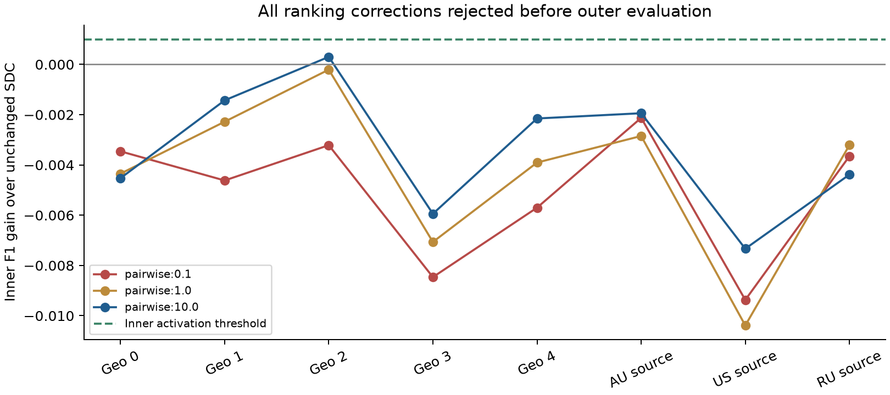
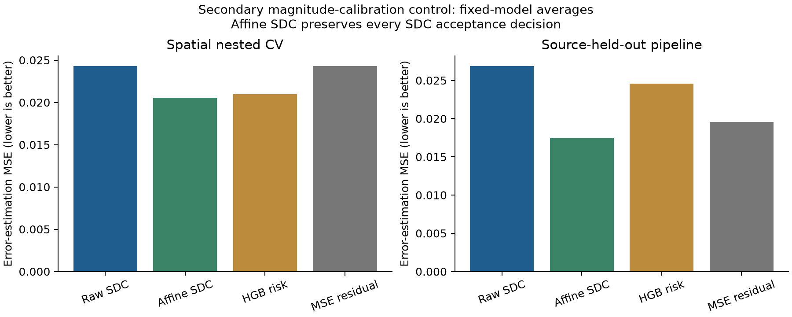

# Ranking and source-transport studies — 16 November 2026

**Later E3 update:** [locked larger-plot confirmation](confirmation_e3_results.md)
does not support transferring E2's scalar-SDC/HGB joint advantage. MSE point
ordering reverses in all four settings; F1 uncertainty is wide. A post-primary
training-mean-only control also beats scalar SDC's E2 point MSE. Keep the E2
numbers below as development evidence; do not interpret the magnitude result
as useful incremental confidence information or a confirmed global winner.

**Both planned CPU studies are complete. The ranking candidate does not earn GPU
promotion. A stronger magnitude-calibration control changes the interpretation
of the earlier learned-error result.** No GPU replay was launched for this
candidate because its scientific promotion criterion failed.

## Design and executed work

Use the four public SAGE predictor settings from E1: optimized DeepSDM s0/s1 and
random forest s0/s1. Use only 1,165 probability-calibration and 1,061
risk-calibration cells. **No E1 assessment targets were requested in E2.** These
calibration labels were already consumed, so this is development, not independent
confirmation. E1 reports, policies, source snapshots and manifests remain unchanged.

The [configuration](../configs/ranking_study_e2.json) and
[protocol](ranking_study_e2_protocol.md) were hashed before fitting candidates.
The candidate adds a regularized linear correction to SDC, trained using
within-country/area pairwise logistic loss weighted by observed F1 differences.
Pairwise ranking is established prior work
([RankNet](https://www.microsoft.com/en-us/research/publication/learning-to-rank-using-gradient-descent/));
no new optimizer or theoretical guarantee is claimed. Three penalties (.1, 1, 10)
and the unchanged SDC option are selected by nested utility validation, with an
inner activation threshold of +.001 F1. One penalty is shared across four model
settings. Normalization is fit on training rows only.

Two studies actually ran:

1. **Five buffered outer geographic folds**, each with three buffered geographic
   inner folds. All 1,061 risk-calibration cells receive out-of-fold predictions.
   Probability calibration stays in the separate original probcal role.
2. **Three source-held-out pipelines**, chosen by metadata support, excluding each
   source from both reliability-calibration roles, refitting probability
   calibration and area bins, and applying the same inner selection procedure.

| Held-out source | Evaluation cells | Evaluation blocks | Remaining probcal | Remaining risk training |
|---|---:|---:|---:|---:|
| AU-AU-002 | 480 | 6 | 806 | 581 |
| NA-US-002 | 232 | 5 | 814 | 829 |
| AS-RU-002 | 83 | 4 | 1,019 | 953 |

There are 795 unique source-study evaluation cells across 15 blocks; the spatial
study has 30 blocks. The source exclusion applies to our reliability pipeline,
not the released backbone models' original presence-only training. All methods
receive identical country/area quotas within every evaluation fold. Rounding
yields 850/1,061 retained cells in the spatial study and 636/795 in the source
study. Fold-specific target coverage is 80%; the pooled fraction need not be
exactly .8 after separate largest-remainder rounding.

Compute: 288 small pairwise linear fits, 292 closed-form MSE residual fits, 32 HGB
controls, 32 scalar affine controls and 16 probability-calibration transforms.
These are low-dimensional CPU fits, not independent datasets or new neural SDM
training. The primary runner reached its last fold in about 30 seconds locally.

## Primary ranking result: rejected before outer evaluation

All five spatial folds and all three source folds choose **unchanged SDC** for
the primary pairwise method. Every ranking candidate misses the +.001 inner
activation threshold. The best pairwise inner gain anywhere is only +.000300;
23 of the 24 fold/penalty contrasts are negative. The outer procedure therefore
makes exactly the same acceptance decisions as SDC everywhere.

Its measured outer F1 and rare-occurrence differences are consequently zero.
The [0,0] intervals reflect policy identity, **not evidence that every possible
learned ranker is equivalent to SDC**, and not uncertainty about a deployed
nonzero learned correction. Inner rejection is the relevant finding.



The MSE-residual control activates only for the Australian source fold. Its
pooled source-study change is -0.001684 F1, descriptive 95% spatial interval
[-0.004675,+0.000163], with -1.887 percentage points of rare-occurrence service.
A favorable inner result did not deliver a reliable source-transport improvement.
It is not substituted for the failed primary candidate.

## Stronger calibration control: useful secondary finding

E1's explanatory diagnostic compared HGB with the **raw** 1-SDC error estimate.
E2 adds a training-only monotone-affine SDC calibration. Positive slope preserves
SDC ranking and all acceptance decisions exactly, while fitting error magnitude.
This provides a simpler comparator for the earlier squared-error interpretation.

Fixed-model averages:

| Study | Raw SDC error MSE | Affine SDC error MSE | HGB error MSE |
|---|---:|---:|---:|
| Buffered spatial CV | 0.024298 | **0.020571** | 0.020968 |
| Source-held-out pipeline | 0.026871 | **0.017511** | 0.024551 |

The affine control beats HGB's error MSE in **all four source-held-out model
settings**, and three of four spatial settings. The spatial average difference
is inconclusive: HGB minus affine MSE +0.000396, descriptive 95% block interval
[-0.001467,+0.001963]. The source-study difference is **+0.007039**, interval
**[+0.003595,+0.010306]**, using shared spatial resamples across the fixed models.
These are secondary development intervals; four seeds/settings are not four
independent datasets. Source sample sizes are limited.

This weakens an interpretation that HGB's lower MSE versus raw SDC was useful
incremental capability. Much of that apparent advantage disappears against a
proper magnitude-calibration control. In the source study, the scalar control
simultaneously preserves SDC's better selection and attains lower MSE than HGB.
It is an empirical comparison in these settings, not an invention of monotone
calibration or proof that learned error regression never helps.



## Selection and ecological service remain different objectives

Under the same source-held-out quotas, HGB loses **0.007246 F1** to SDC on average,
descriptive interval [-0.013156,-0.000562], while retaining **1.984 percentage
points more rare occurrences**. The spatial HGB F1 change is -0.002733, interval
[-0.007069,+0.002706]. Do not characterize every ecological-service change as an
accuracy improvement or turn the source-study tradeoff into a universal rule.

The source-study SDC rare coverage is around 78.1%, unlike E1's roughly 81.4%.
The cohort, training-source support and calibration differ; raw numbers across
the two studies do not isolate a causal source-shift effect.

A post-hoc, nondeployable label oracle shows that an optimal selection using
observed F1 could gain 0.0255–0.0326 F1 over SDC in the spatial study, at the same
country/area budgets. It does not enforce a rare-service constraint and uses
evaluation outcomes directly. It is an optimistic ceiling, not a method result.
The tested learners' failure does not establish that useful selection headroom
or future scientific contributions are impossible.

## GPU decision and validation

Correctness checks pass. Scientific admission fails because neither study shows
the required >=.002 F1 gain and positive interval lower bound. No GPU job is
launched for this inactive ranking candidate. This is a scientific stopping
decision, not a request for more permission. Future qualifying GPU runs remain
authorized by the user; E2's specific stage is one private, <=20-minute GPU head
replay, not a fresh backbone accuracy result.

**50 focused tests passed.** They cover analytic ranking gradients, paired-group
construction and permutation, training-only scaling, buffered splits, target-role
projection, baseline fallback, monotone-order preservation and joint spatial
uncertainty. An independent artifact audit reconstructs 35 outer/inner/probcal
buffer checks (minimum 51.65 km), source exclusions from both roles, all split
ID hashes, source snapshots, unchanged E1 manifest and equal policy budgets.
No historical full-suite green claim, publication claim or new competition score.

Reproduction uses ignored inputs and the repository's persistent Python 3.12
environment:

```bash
PYTHONPATH=src:.:scripts OMP_NUM_THREADS=2 OPENBLAS_NUM_THREADS=2 .venv/bin/python scripts/study_ranking_e2.py
PYTHONPATH=src:.:scripts MPLCONFIGDIR=/tmp/glc-e2-matplotlib .venv/bin/python scripts/summarize_ranking_e2.py
PYTHONPATH=src:.:scripts OMP_NUM_THREADS=2 .venv/bin/python scripts/validate_ranking_e2.py
```

The runner refuses to overwrite completed E2 results. Preserve the existing
study and use a separate output directory for any clean rerun. Reports, held-out
development rows, inner choices, snapshots, source audits, GPU admission receipt
and standalone PNG/PDF figures are in `results/ranking_study_e2/`.

## Consequence for the paper

Stop expanding this small summary-feature ranking family for now. The accumulated
evidence supports a narrower empirical paper about **strong decision-confidence
baselines, magnitude calibration versus selection, and ecological service under
source shift**. A new successful learning algorithm remains unestablished.
The contribution must be assessed against SDC, SAGE and established selective
prediction/ranking work.

Next, turn the existing results into a claim/prior-work matrix and a methods/results
draft, then specify a newly audited source/domain confirmation for one narrow
primary claim. Any richer-representation method needs a concrete hypothesis and
calibration-only admission before the already-authorized GPU stage. Further
hyperparameter sweeps on these consumed outcomes do not supply fresh evidence.
