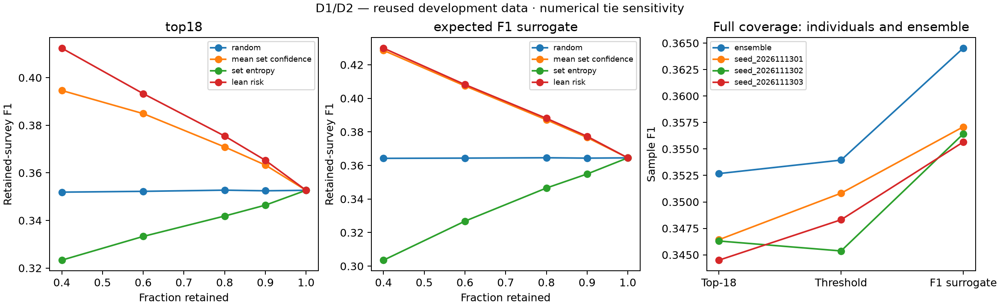

# D1–D3 findings and thesis decision — 14 November 2026

**Completed:** the first three diagnostic studies, an external-data metadata audit
and a working paper outline. **Zero new neural models trained.** Six existing R1
checkpoints were reused in two bounded inference jobs. All results below are
development evidence on historically consumed labels, not independent
confirmation or a new Kaggle score.

The strongest new lead is **decision alignment**: the incremental value of a
learned error selector becomes much smaller after improving the species-set
decoder. Ensemble averaging still helps. The tested regional extensions do not
establish a useful new method. These findings favor a focused empirical
replication before additional architecture/training sweeps.

## D1: choosing the species set changes the reliability conclusion

All decoders use the same saved ensemble weights. Probability calibration and
threshold selection use their assigned probability-calibration role; error
regressors use the separate risk-calibration role. Sizes are bounded to 8–40 for
threshold and expected-F1-surrogate decoding. These are controls for this study,
not assertions of a novel or optimal decoding algorithm.

| Ensemble decision rule | Full-coverage sample F1 | Species-count MAE |
|---|---:|---:|
| Fixed top-18 | 0.352675 | 7.63177 |
| Calibrated global threshold | 0.353949 | **7.53953** |
| Expected-F1 ratio surrogate | **0.364523** | 7.79366 |

The expected-F1 surrogate gains **0.011848 F1** over fixed top-18, with descriptive
spatial interval **[0.008055, 0.015585]**, despite worse count error. The threshold
improves count error but its F1 gain is only 0.001275, with interval spanning zero.
This reinforces the distinction between richness estimation and species-set
utility. It does not establish Bayes optimality or biological causality.

At **80% retention under identical country/area quotas**, compare a lean learned
error model with mean confidence in the actually predicted set:

| Decision rule | Simple mean-set confidence | Lean error regressor | Incremental F1 |
|---|---:|---:|---:|
| Top-18 | 0.370896 | 0.375481 | +0.004585 |
| Calibrated threshold | 0.377739 | 0.380786 | +0.003048 |
| Expected-F1 surrogate | **0.387211** | 0.388096 | **+0.000885** |

For the expected-F1 decoder, the interval on the lean-versus-simple-confidence
gain is **[−0.000571, +0.002516]**. The apparent selector benefit is not robust to
the choice of decision rule in this experiment. This is consistent with a
decision-mismatch explanation for part of the earlier gain; it is not a causal
proof that the decoder explains every effect. All feature families/decoders were
declared before these follow-up comparisons, but after the earlier R1 study.

Predicted-set entropy, accepted in ascending order, performs worse than random
for all three ensemble decoders at 80% retention: 0.341862 versus random 0.352734
for top-18; 0.338370 versus 0.354252 for threshold; 0.346536 versus 0.364586 for
the F1 surrogate. Entropy's correlation with F1 remains positive. Binary entropy
is low for confidence in absence as well as presence; forcing a positive species
set changes what uncertainty is relevant. The observation needs replication and
calibration controls; no universal entropy-failure claim is justified.

For the expected-F1 decoder, simple confidence recovers **778 rare positives**
and retains **75.323%** of rare-species occurrences at 80% survey retention. The
lean model recovers **775** and retains **74.366%**. Thus the slightly higher
conditional F1 of the lean model does not establish an ecological-service benefit.
Rarity here is training-fold prevalence 1–25, not conservation threat status.

A secondary full-coverage precision/recall summary makes the tradeoff explicit:
the F1 surrogate raises rare-species recall from **2.90% to 5.08%**, while rare
precision falls from **13.98% to 12.36%**. The threshold decoder attains micro-F1
0.369459 versus the surrogate's 0.366432, despite lower sample-averaged F1. The
preferred decoder depends on the declared utility. These are additional
descriptive summaries of the same saved predictions, not independent findings.
The reproducible summary is `scripts/summarize_decoder_rare_metrics.py`.

## D2: keep averaging distinct from disagreement features

Using **original immutable R1 outcomes and member sets**, ensemble full-coverage
F1 is **0.352688**, versus **0.345755** for the arithmetic mean of the three
individual-model F1 values. Gain: **+0.006932**, descriptive spatial interval
**[+0.005990, +0.008528]**. This original-reference comparison is unaffected by
the regenerated-output numerical issues described below. Averaging improves both
folds in this saved-model experiment.

With regenerated expected-F1 decoding, the ensemble scores 0.364523 versus mean
individual-model F1 0.356387: gain **0.008136**, interval [0.006868, 0.009900].
Report individual seeds as well as the ensemble. Three members are not three
independent ensemble trials, and the interval conditions on the fixed fitted models.

R1's post-hoc ablation showed no clear incremental selector value from
disagreement features beyond decision confidence. That finding does **not** imply
that averaging can be removed. The present evidence favors retaining averaging
while simplifying the error-selection features.

## D3: the tested regional extensions did not earn a new-method claim

Four fixed CPU error-model variants were compared: pooled lean, country-weighted
lean, country-local blending and bioregion-local blending. Local models require
100 calibration surveys and use shrinkage n/(n+200). Three inner spatial folds of
risk-calibration data selected country weighting, before assessment outcomes were
used. Calibration IDs are shared between the two outer neural-model folds;
these are two prediction views, not independent doubled calibration observations.

| Top-18 selector at matched 80% retention | F1 |
|---|---:|
| Pooled lean | **0.375639** |
| Calibration-selected country weighting | 0.375095 |
| Country-local blend | 0.374737 |
| Bioregion-local blend | 0.374300 |

The selected candidate loses **0.000545 F1** versus pooled lean, with interval
[−0.001929, +0.000450]. The supported-country non-regression check also fails:
Germany changes by −0.005306 and Bulgaria by −0.005268 relative to pooled lean.
These are observed threshold failures, not strong evidence of general countrywide
harm. Small-group uncertainty remains substantial. Switzerland has only nine
risk-calibration surveys versus 49 assessment surveys, illustrating the limited
support available for country-specific reliability estimation.

The regional variants also do not exceed simple confidence's rare-positive
recovery. A negative control confirms that adding a constant country risk offset
changes **zero** acceptance decisions under country/area quotas. Constant offsets
cannot fix within-group ordering. This is a basic ranking property, not a new theorem.
Hypothetical referral-cost sensitivity is saved separately; no field costs or
conservation benefits were measured.

**Decision:** stop expanding this simple regional-variant family for now. A failure
of these variants does not establish that all regional methods fail. Do not tune
a special Swiss/Bulgarian exception using their inspected assessment outcomes.

## External-data audit: a concrete route, not completed confirmation

The [metadata audit](independent_reliability_data_audit.md) identified the recent
[SAGE preprint](https://arxiv.org/abs/2609.31082) and its released data/models.
Its species-level sampling-aware framework already covers the broad framing of
sampling-aware evaluation. The candidate paper question needs to remain narrower:
site-level species-set decisions and selective geographic/ecological service.

Read only survey covariates/provenance, excluding external species targets and
model prediction values. Of the available metadata, **2,398 source-plot rows lie
within 1 km** of existing GeoLifeCLEF PA locations; proximity is not proof of
identical surveys but precludes assuming that the whole release is nonoverlapping.

A conservative covariate-defined candidate has **11,130 cells**, **15,654 source
plots**, **36 source groups** and **34 countries**. Every contributing plot is
outside Europe, at least 500 km from existing PA train/test, has known positional
uncertainty <=1 km, area 10–400 m² and a non-European-prefixed known source ID.
Minimum measured distance is 567.94 km. Candidate IDs are hashed; a final
confirmation cohort and species-support policy are not yet locked.

Public archive headers show that evaluation covariates total about **7.35 MB**,
with released checkpoints/predictions available separately. Reusing suitable
baselines may reduce the previous six-fit external allocation. Predictor/mask
alignment, survey completeness, source overlap and the external calibration/test
protocol still need to be fixed before labels are opened. No taxon identities
were recovered from anonymized GeoPlant labels.

## Numerical integrity and actual compute

Two private T4 inference sessions took **36.49 and 24.88 minutes** inside their
notebooks (about 61.38 minutes total, excluding queue/provisioning). No optimizer
or neural training run was added. The second reused exported normalization and
read imagery only for 49,077 inference-role surveys. It exported float32 ensemble
means and per-member decision tables, avoiding another reconstruction for future
CPU work. All **nine manifest-listed aligned outputs** were downloaded and hash
verified, plus the manifest: **990,280,691 bytes** total.

The first run failed literal member-set equality. The aligned run also fails
that original exact-set guard; neither failure is hidden or relabeled. A recorded
technical amendment, before the new reliability contrasts were inspected, added
a separate **label-free raw-float16 rank-boundary audit**. Across members,
99.9469–99.9796% of reference sets lie within two raw rounding units at the top-18
boundary. The aligned ensemble's F1 matches on at least 99.9113% of surveys, with
fold mean differences below 0.000014. A small number exceed two units; they remain
visible in the report's maximum-gap diagnostics. This is numerical-sensitivity
evidence, not bitwise reproduction.

Regenerated D1/D2 results therefore carry a numerical-tie-sensitivity qualifier.
The exact original R1 averaging comparison is reported separately. F1 success
margins, the failed R1 regional safeguard and scientific method choices were not
relaxed. Every spatial interval is conditional/descriptive under adaptive reuse;
none constitutes independent significance or a risk guarantee.

The final focused suite has **50 passing cases**, including saved-checkpoint
reconstruction, no-training traps, raw-float16 boundary checks, role batching,
target-free regional predictions and canonical Kaggle references. The vanished
temporary interpreter was replaced with persistent project-local Python 3.12.16;
research package versions stayed unchanged. No system settings were changed.

## Updated next steps

1. **Lock the empirical replication question:** does the selector's apparent
   advantage persist after decision alignment, matched service coverage and strong
   simple baselines? Preserve the negative regional results and explicitly test
   rare-occurrence service.
2. **Audit/reuse external baselines before training more models.** Finalize the
   SAGE-compatible inputs, native-range mask treatment, calibration/selector/test
   roles and nonoverlapping source cohort while external outcomes remain unopened.
   Respect its different 1 km task and label vocabulary. A supervisor-held outcome
   workflow is preferable when feasible.
3. **Admit only the replication work needed by that locked question.** The earlier
   18+6 neural-fit allocation remains conditional and may shrink with artifact
   reuse. No new architecture sweep or competition submission is justified by
   these diagnostics alone.
4. Develop the [working paper outline](paper_outline_working.md) into a manuscript
   after replication determines the contribution. A rigorous empirical paper is
   a plausible route; a new regional algorithm or ecological discovery has not
   been established.

Reproduction methods: [follow-up protocol](reliability_followup_d1_d3.md).
Compact machine-readable evidence is under
`results/reliability_followup_d1_d3/{decisions_ensembles,regional,independent_data}`;
the exact statistical-analysis source snapshot is preserved alongside its design
hash. Large matrices remain ignored. Local changes are uncommitted/unpushed.
