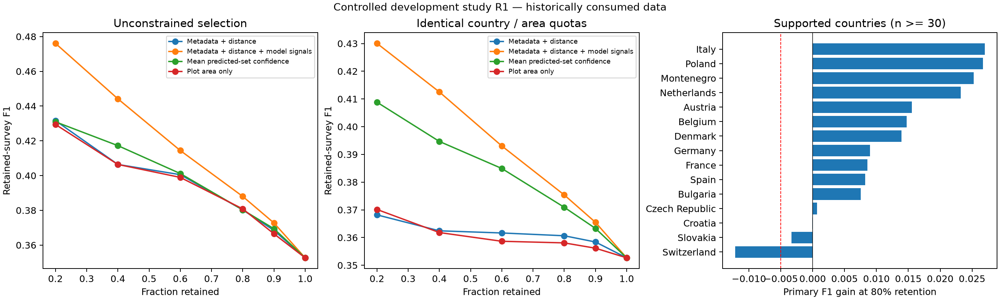

# R1 results and paper decision — 13 November 2026

**Verdict: meaningful controlled development progress; the complete intended
reliability claim did not pass.** Model-derived signals add useful information
beyond survey metadata and distance when geographic/survey coverage is matched.
However, the frozen regional safeguard failed, the improvement over a stronger
simple confidence baseline is smaller, and rare-species benefits are unproven.
This is evidence for a focused next study, not a paper-ready method or a new
Kaggle result.

## Completed experiment and integrity

The private [full notebook](https://www.kaggle.com/code/nmavros/glc25-reliability-r1-full)
completed all six neural fits: two buffered spatial folds, three fixed seeds per
fold, 18 epochs per fit, last EMA checkpoint, all 5,016 PA species. It took
**69.45 minutes inside the notebook** on a Tesla T4, excluding queue/provisioning
and the earlier technical probe/smoke. There was one three-member ensemble per
fold; its members are not three independent ensemble replications.

Downloaded every manifest-listed output: **18 files, 494,642,161 bytes**, plus the
manifest. All 18 hashes matched; executed configuration digest matched the
frozen amended configuration. There are 31,570 unique assessment survey IDs and
no overlap between the two assessment folds. Candidate and baseline retain
exactly the same count in every fold/country/area stratum. The documented
pre-accuracy amendment and original configuration remain available.

The frozen protocol is [reliability_study_r1.md](reliability_study_r1.md).
Machine-readable analysis is
[`analysis.json`](../results/reliability_study_r1/analysis/analysis.json).
Large checkpoints/predictions are in ignored `full_output/`; compact reports and
derived tables are in `full_summary/` and `analysis/`. Credentials remain outside
the repository. There was no competition submission or hidden-test score.

## Frozen primary comparison

All rows below use the same top-18 ensemble predictor and **80% retention with
identical country-by-plot-area quotas**. F1 is conditional on the retained surveys,
which can differ between selectors; it is not full-coverage accuracy.

| Selector | Retained-survey sample F1 | Role |
|---|---:|---|
| Metadata + distance error regressor | 0.360641 | Frozen primary baseline |
| Mean confidence of the predicted 18 species | 0.370927 | Strong simple secondary baseline |
| Metadata + distance + model-signal error regressor | **0.375382** | Frozen primary candidate |
| Full candidate plus environmental novelty | 0.375388 | Secondary ablation |
| Predicted-set entropy, accepting lowest entropy | 0.341870 | Secondary diagnostic |
| Seeded random acceptance | 0.352749 | Secondary control |

The primary gain is **+0.014741 F1** (1.474 percentage points), with descriptive
95% spatial-cluster bootstrap interval **[+0.011134, +0.018025]** across 109 blocks
and 2,000 replicates. Fold gains are **+0.013133** and **+0.016352**. Both methods
retain 25,257 surveys, using the prespecified per-fold integer budgets.

The +0.005 primary utility margin passes. **The regional safeguard fails:** among
15 supported countries (at least 30 assessment surveys), 12 improve, but
Switzerland loses **0.012164 F1**, exceeding the permitted 0.005 regression.
Switzerland has 49 surveys in three spatial blocks, with 38 retained by each
method. This is an observed safeguard failure, not well-powered proof of harm
throughout Switzerland. Slovakia loses 0.003331; Croatia loses 0.000067.
Country/area quotas preserve representation, not accuracy within each group.

Against mean predicted-set confidence, the gain is **+0.004455**, with descriptive
interval [+0.001585, +0.008954]. This secondary comparison is encouraging but is
below the broader draft protocol's +0.005 target over a strong simple baseline.
It must not be replaced in reporting by the larger metadata-only contrast.
Environmental novelty adds only 0.000006; this run provides no useful incremental
benefit for that feature set.



## Findings that narrow the research direction

**Selection composition matters.** At unconstrained 80% retention, metadata plus
distance appears to raise F1 from 0.352688 to 0.380290. An exact descriptive
decomposition assigns 0.023887 of that 0.027602 gain to changed fold/country/area
composition and 0.003715 to selection within those strata. Thus about **86.5%**
is associated with composition in these bins. For the model-signal candidate,
about **65.4%** of its unconstrained gain is the composition component. These are
reweighting identities, not causal attributions; they depend on the chosen strata.
The matched-quota result is the more relevant test of added reliability information.

**Raw entropy can disagree with the actual prediction decision.** Predicted-set
entropy performs worse than random here. Its Spearman correlation with F1 is
positive (+0.319), although the rejection rule treats higher entropy as higher
risk. Binary entropy is low for both near-zero and near-one probabilities; low
probability of presence can mean confidence in absence while the top-k decoder
still forces a positive prediction. This is a plausible explanation to test with
other decoders and models. It is not evidence that entropy fails universally.

**A simpler confidence model explains the gain.** A separately labeled,
post-hoc CPU ablation used risk-calibration labels only for fitting, with the
same fixed regressor parameters. It required 14 small regressor fits and no new
GPU training. These feature comparisons were designed after inspecting R1 and
are exploratory, not new primary tests:

| Inputs added to metadata + distance | F1 at matched 80% retention |
|---|---:|
| Total probability mass only | 0.360834 |
| Decision confidence: mass, maximum probability, mean top-18 confidence, expected-F1 surrogate | **0.375639** |
| Decision confidence plus entropy | 0.375434 |
| Ensemble disagreement/variance/information only | 0.372844 |
| Decision confidence, entropy and ensemble signals | 0.375382 |

Adding ensemble signals to decision confidence plus entropy changes F1 by
−0.000052, with descriptive interval [−0.000529, +0.000395]. There is **no clear
incremental benefit from the disagreement features** in this experiment. This
does not show that model averaging is unnecessary: the confidence features
themselves come from ensemble-mean probabilities. The local full-feature replay
reproduced the GPU primary F1, but local and Kaggle scikit-learn versions differ.

**Average F1 is insufficient for a conservation claim.** Rare taxa are defined
using 1–25 positive surveys in the corresponding training fold. Full-coverage
recall for these taxa is only **2.90%**. At matched 80% survey retention, the main
candidate retains **73.75%** of rare-species occurrences and recovers 439 rare
positives. Simple mean confidence retains **76.74%** of those occurrences and
also recovers 439 positives. The F1 gain has not established better rare-species
recovery or beneficial conservation decisions. See
[`rare_species_coverage.csv`](../results/reliability_study_r1/analysis/rare_species_coverage.csv).

**Prediction-set decisions remain a useful mechanism study.** The prespecified
secondary expected-F1 count surrogate improves full-coverage sample F1 from
**0.352688 to 0.364513**, while count MAE worsens from **7.63177 to 7.79398**.
This reinforces the distinction between estimating richness and optimizing
species-set F1. It is a secondary result on the same reused data, not a matched
comparison to the competitive v32 system or proof of an optimal decoder.

## What we can claim now

- On this controlled, reused two-fold development experiment, model confidence
  improves retained-survey F1 beyond metadata and training distance under equal
  country/area retention budgets; both folds agree.
- Unconstrained selective gains can substantially reflect which survey types and
  countries are retained. Coverage controls change the conclusion about baselines.
- Regional non-regression, rare-species benefit, added value of ensemble
  disagreement and independent generalization are **not established**.

All PA labels were used historically. The bootstrap conditions on the saved fits
and selection rules; it does not correct historical adaptive reuse, establish
independent significance or measure uncertainty over new ensemble training runs.
Full probability arrays were exported as float16, so tied species rankings may
change if reconstructed from them. Exact primary scores/features/acceptance masks
are in CSV; individual member top-18 indices and checkpoints are preserved.

These internal retained-survey F1 values cannot be compared numerically with a
full-coverage Kaggle private score. The best recorded competitive recipe remains
v32 (private 0.21514); R1 gives no new evidence that the winner can or cannot be
beaten.

## Recommended next work, in order

The [proposed five-study budget](next_experiment_budget.md) turns these priorities
into staged comparisons: first three reuse existing outputs/checkpoints with no
new neural training; model/spatial replication and independent confirmation have
a conditional planning budget of 18 and six new neural fits. No new job is
launched by that plan, and no experiment count guarantees a publishable result.

1. **Freeze stronger, simpler baselines before more training.** Use mean-set
   confidence and the lean decision-confidence error model as primary comparators.
   Examine confidence calibration, entropy versus decision loss, and decoder
   changes using the existing exports. Evaluate the same predictor/decoder at
   identical coverage, including rare occurrence coverage and referral costs.
   Do not change the failed R1 safeguard retrospectively.
2. **Test the cost of ensemble reliability separately.** Reuse the six checkpoints
   for an inference-only single-model versus ensemble comparison before buying
   more neural fits. Existing exports lack per-member confidence summaries and
   normalization objects; preprocessing must be reconstructed from the frozen
   fold/source, checked, and exported for future reuse. Compare averaging's accuracy
   benefit separately from disagreement's selector benefit. Do not infer either
   from the present ablation.
3. **Design R2 around regional failure and rare-species service.** Compare pooled
   and region-shrunk error estimators and declared calibration-only fallback rules.
   Select rules/hyperparameters on training/calibration roles only, then lock the
   analysis. Evaluate multiple outer geographic domains and block/buffer scales;
   retain small-country counts and uncertainty. Country quotas alone are already
   a baseline, not a new guaranteed-risk method. No promise that a fallback fixes
   Switzerland is justified from its inspected assessment outcomes.
4. **Secure independent confirmation before a large sweep.** Current GeoPlant
   IID/OOD metadata partition exactly the old 14,784 unlabeled GLC25 test IDs;
   they are not new labeled validation data. sPlotOpen is a candidate requiring
   source/spatial overlap, survey completeness, licensing and predictor audits.
   Deduplicate its overlapping resamples; exclude composition-derived community
   traits from predictors. Respect anonymized GeoPlant species identities; a new
   dataset-specific label space can replicate the method without deanonymization.
   Prefer supervisor-held outcomes for the final locked analysis.
5. **Then test transfer across model families.** A compact environmental/Landsat
   baseline and a stronger multimodal/competitive model should test whether the
   confidence/decision findings persist. Repeating seed/architecture sweeps on
   these same labels cannot supply independent scientific confirmation. Keep a
   v35 benchmark attempt optional and separately budgeted.

The strongest paper direction is **decision-aligned reliability under geographic
and survey shift**, demonstrating what remains after coverage controls, when
common uncertainty scores fail, and whether a simple regional method improves
service without losing rare taxa. Generic confidence regression, quotas and fair
selective prediction already exist; novelty needs a verified mechanism, a useful
method beyond strong baselines, or a rigorous replicated benchmark finding.
This experiment narrows that question; it has not yet earned a novel algorithm
or an ecological discovery.

## Reproduction and validation

From the repository root, after retrieving the manifest-listed full outputs:

```bash
PYTHONPATH=src:. OMP_NUM_THREADS=2 MPLCONFIGDIR=/tmp/glc-mpl .venv/bin/python \
  scripts/analyze_reliability_study.py \
  --input results/reliability_study_r1/full_output/r1_export \
  --output results/reliability_study_r1/analysis
PYTHONPATH=src:. OMP_NUM_THREADS=2 .venv/bin/python scripts/posthoc_reliability_ablation.py
```

The main analysis verifies all output hashes and the frozen configuration before
calculating results. Tests cover quotas, ensemble calculations, training-only
transformations, the synthetic 5,016-label neural/calibration/export pipeline and
the exact composition decomposition. The final focused suite result is recorded
in `results/reliability_study_r1/evaluation_validation.json`. The historical full
suite's earlier fixture/hash failures remain separately documented; no full-suite
green result is claimed.
