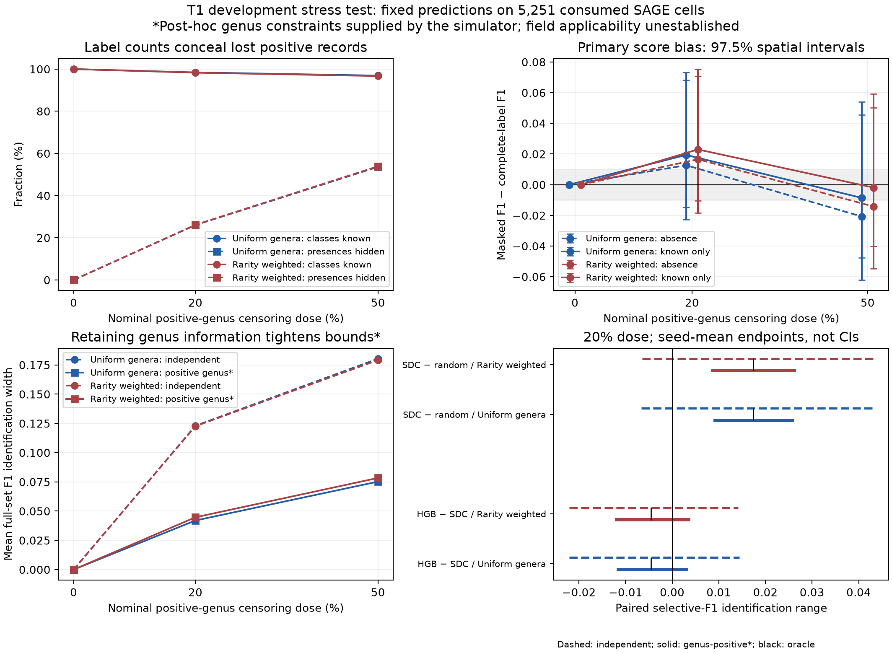

# T1 results: taxonomic observability and fixed selective decisions

Completed 17 November 2026. **Useful measurement diagnosis; the declared
development criterion fails. No successful new method or independent
confirmation is established.** All 60 planned mask settings ran on 5,251
historically consumed SAGE assessment cells, with fixed predictions and five
fixed selectors. No tested paired policy ordering reverses. E4's failed
confirmation and original artifacts remain unchanged.

## Design and integrity

The [protocol](taxonomic_resolution_t1_protocol.md) fixes E4's 2,453-class
modeled universe intersected with each cell's original native mask, one released
aggregation_s0 MLP, its frozen probability calibration and expected-F1 decoder.
Reconstructing the E4 HGB once on its original 1,061 risk-calibration cells
reproduces saved NEON predictions with **zero numerical error**. No assessment
labels enter fitting or selection. This adds one CPU head reconstruction,
**zero new backbone fits, GPU jobs or competition submissions**. CPU inference/
policy preparation takes 5.81 seconds, excluding process imports and freezing.
Published-reference maximum/mean errors are 9.239e-7 / 1.083e-9.

Local freeze chronology: protocol/input/source identities **07:49:24 UTC**,
fixed policies **07:49:42**, first T1 assessment materialization **07:49:59**.
This protects this development analysis from target-driven changes; it does not
make historically consumed E1 labels fresh. Quotas retain 4,201 cells identically
within 83 country × area groups. There are 32 countries and 73 original spatial
blocks. Ten mask seeds measure synthetic variability, not independent ecological
replication. Spatial intervals use 4,000 paired block draws and are conditional
on the fixed policies/cohort.

SAGE's metadata genus agrees with the first token of every one of 5,771 canonical
class names; the fixed universe spans **957 genera**. Training-only
relative prevalence sets genus weights; assessment/test prevalence is not read.
The synthetic mechanisms hide all positive **and negative** eligible labels in
selected positive genera. No hidden positives are restored to the scoring labels.
Genus choices are informative by construction and do not estimate NEON's actual
identification mechanism. Native eligible counts range from 51 to 744 per cell.

## Primary results

The complete-recorded-label oracle has mean F1 **.253797**. Selective F1 points
are HGB .266088, SDC .270637, deterministic random .253268, mean confidence
.271199 and predicted-set entropy .243996. HGB minus SDC is **−.004548**, 97.5%
spatial interval **[−.011809,+.003181]**; its direction is already statistically
uncertain before censoring. SDC minus random is +.017369 [.009786,.028053].
These results concern the fixed reduced native universe and this cohort.

At nominal 20% censoring, mean class-known fraction remains **98.42% / 98.29%**
(uniform / rarity weighted), while **26.02% / 26.14% of positive occurrences**
are hidden. Every cell still passes the >=80% class-known rule. Thus that rule
does not certify utility observability in this controlled mechanism. It does
not follow that the same rates occur in NEON.

| Mechanism | Nominal dose | Classes known | Positive occurrences hidden | Unknown-as-absence F1 bias | Known-label-only F1 bias |
|---|---:|---:|---:|---:|---:|
| Uniform positive genera | 20% | 98.42% | 26.02% | +.012678 [−.022767,+.068073] | +.019383 [−.014867,+.073079] |
| Rarity weighted | 20% | 98.29% | 26.14% | +.016565 [−.018313,+.070594] | +.022982 [−.010589,+.075363] |
| Uniform positive genera | 50% | 96.90% | 53.64% | −.020770 [−.062107,+.045547] | −.008608 [−.047690,+.053871] |
| Rarity weighted | 50% | 96.70% | 53.89% | −.014218 [−.054654,+.050180] | −.001887 [−.040290,+.059065] |

Bias is masked minus complete-recorded-label F1, averaged across ten seeds;
brackets are 97.5% paired spatial intervals. The declared criterion requires a
20%-dose bias interval wholly outside [−.01,+.01] under both mechanisms.
**It fails.** Narrow seed ranges cannot substitute for the much wider spatial
intervals. For example, uniform-20% known-only bias ranges .018664–.020215
across seeds, while the spatial interval crosses zero.

Rounding matters: the rule is `ceil(dose × distinct positive genera)`, so the
nominal 20% dose hides a mean **33.92%** of positive genera on a per-cell scale
(zero-positive cells contribute zero); the occurrence-weighted fraction is
26.02–26.14%. A single-positive-genus cell loses that entire genus at either
nonzero dose. These are nominal doses, not exactly 20% per-cell missingness.

## Paired policy comparisons and identification

At 20%, known-only HGB-minus-SDC contrast distortion is **+.000962** (uniform)
or **+.000645** (rarity weighted); both spatial intervals cross zero.
Known-only HGB-minus-random distortion is +.002990 / +.003085, also inconclusive.
Across both nonzero doses, both treatments and all seeds, no measured contrast
distortion reaches the .01 practical threshold and **no practical oracle
contrast changes sign**. This experiment does not demonstrate ranking reversal.

Elementary independent-label completion bounds have mean per-cell F1 width
**.122958 / .122618** at 20%, increasing to .180338 / .179157 at 50%.
At 20%, seed-mean HGB-minus-SDC endpoints are **[−.022071,+.014381]**
and **[−.022113,+.014157]**. SDC-minus-random endpoints also span zero.
All ten seeds of both mechanisms leave each of the three paired contrast signs
unidentified at each nonzero dose. These are possible-completion ranges,
**not confidence intervals**; the original oracle's actual point ordering
nevertheless remains unchanged by the two scoring treatments.

The >=80% rule retains every cell/country/block and all recorded rare occurrences
at 20%. At 50%, each replay retains 5,246–5,251 cells, all 32 countries and all
73 blocks; mean rare-occurrence retention is 99.76% / 99.61%. This simulator
therefore does **not** produce a major geographic/rare attrition effect. Do not
claim it replicates E4's contract-specific attrition. Quotas were not reallocated
after the diagnostic admission filter.

## Post-hoc diagnosis, kept separate

The fixed decoder makes **1,384 empty predictions**. The complete recorded oracle
has 915 zero-positive cells; 523 coincide with empty predictions and contribute
523/5,251 = .099600 to F1 under empty/empty = one. Of the 861 positive-truth cells
with empty predictions, **268 become falsely perfect after censoring**, at every
nonzero setting and seed. This adds exactly **.051038** to average score bias.
Negative bias on nonempty predictions and positive apparent-empty bias can
cancel or change the overall direction. This is an exact score decomposition,
not a causal ecological explanation.

The [separately recorded post-hoc diagnosis](taxonomic_resolution_t1_posthoc.md)
evaluates empty/empty = zero and retains the simulator's known-positive-genus
constraints. Neither changes the primary result. Empty/empty = zero changes the
estimand; positive-genus constraints require information genuinely supported by
the observation contract and cannot be inferred from real missingness masks.
The simulator guarantees an eligible positive in every censored genus; a real
higher-rank record could refer to an outside-universe taxon. Do not retrofit
these constraints into E4 without the pending field taxonomy audit.

With empty/empty = zero, moderate-dose known-only bias becomes **−.031655**
[−.041997,−.019186] under uniform censoring and **−.028056**
[−.038399,−.016375] under rarity weighting. These post-hoc intervals concern a
different estimand; they do not rescue the original failed criterion. Oracle
F1 itself changes from .253797 to .154197 under this convention.

Keeping the simulator's positive-genus constraints reduces moderate-dose mean
completion width from **.122958 to .041951** (uniform) and **.122618 to .044705**
(rarity weighted): approximately **66% / 64% narrower**. All ten seeds then
identify positive HGB-minus-random and SDC-minus-random contrasts at 20%.
SDC-minus-random remains identified at 50%; HGB-minus-SDC remains unidentified
under both doses/mechanisms. Uniform-20% SDC-minus-random endpoints average
[+.009223,+.025726], versus independent-label endpoints [−.006655,+.043022].
These are finite-cohort identification statements, not statistically significant
population comparisons. Bounds still include every complete recorded oracle
and nest inside the original ranges across all 315,060 cell-replay settings.

The useful distinction is **discarding genus-level information versus preserving
justified logical constraints**, rather than merely scoring more known labels.
The constraints are supplied by the simulator; this is not evidence that they
can be imposed on real unmodeled or higher-rank records. A successful ecological
method or field-general effect remains unestablished.

## Validation and paper implications

**36 focused primary tests pass**, followed by **six** post-hoc tests including
exhaustive constrained binary completions. An independent full-matrix scorer
reproduces every primary score exactly across **315,060 cell-replay checks**;
all 60 mask hashes, zero-dose identities, all fixed group allocations, oracle
containment and a separately implemented spatial interval pass. Historical
E1/E2/E3/NEON-feasibility/bridge/E4 manifests remain unchanged
(44/24/48/3/665/249 files). No whole-repository test-suite claim is made.

A second independent check constructs feasible lower/upper completions in
**12,000 deterministic cell-replay cases**, attaining both post-hoc genus
endpoints with zero error. Python-based sorting independently reproduces all
five selectors and all 83 largest-remainder group allocations. The standalone
PNG/PDF figure was visually inspected. Original primary files and the post-hoc
analysis source identities are unchanged.

This is meaningful progress toward an empirical evaluation paper: a reproducible
measurement stress test, a quantified limitation of class-count admission, and
an explicit scoring/observation-contract diagnosis. It does **not** establish a
new algorithm, a universal ranking failure, robustness to real taxonomic
missingness or publication-level novelty. The [targeted prior-work review](taxonomic_evaluation_prior_work.md)
finds direct precedents for active evaluation and performance partial
identification. Broad claims to invent either are untenable.

Next finish the NEON species-parent/name/identification-history contract and
record which genus-level constraints are actually justified. For any further
controlled experiment, separate the rounding/low-richness mechanism from other
missingness before proposing a verification method. Such a method needs a
realistic query-cost model, matched active-testing controls and calibration-only
selection. Existing outcomes supply development only. More generic neural/GPU
sweeps are not warranted by this result.

Artifacts: `results/taxonomic_resolution_t1/summary.json`, `replay_summary.csv`,
`country_admission.csv`, `validation.json`, source snapshots and the separate
`posthoc/` directory. Ignored input/prediction/oracle caches are in
`data/taxonomic_resolution_t1/`. Reproduction commands are the script's
`freeze`, `policy`, `replay` phases, the independent validator, then the post-hoc
analysis script; completed phases refuse to overwrite results.
