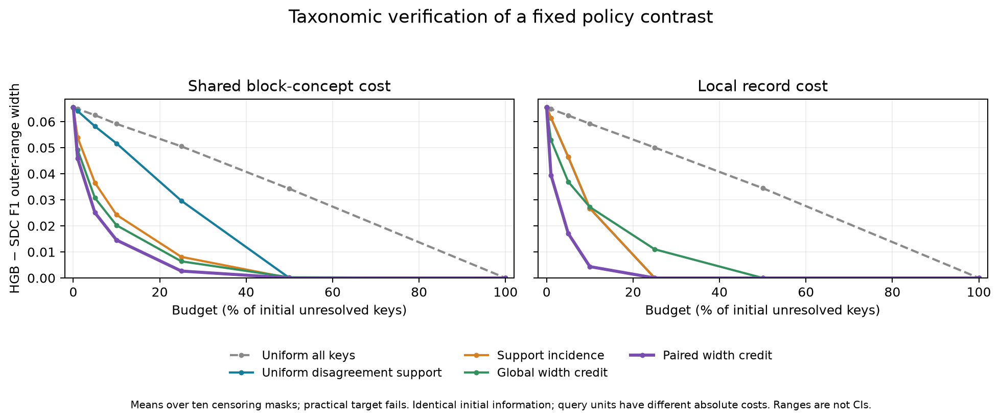

# T2: shared-concept verification costs

Completed 19 November 2026. **The frozen practical target fails.** A predeclared
secondary stopping-cost endpoint provides a useful conditional lead: paired
width priority reaches a practical finite-cohort ordering with fewer queries
than the strongest tested controls in both cost settings. This does not replace
the failed primary criterion or establish publication-level method novelty.

## Executed study

The [protocol](taxonomic_verification_t2_protocol.md), configuration and source/
input hashes freeze at **13:35:57 UTC**, before the T2 replay. All outcomes were
already consumed historically. The replay uses all **5,251 cells / 73 original
spatial blocks / 32 countries**, the fixed T1 MLP predictions/decoder and HGB/SDC
acceptance sets. Both retain 4,201 cells with identical country/area quotas.
The 2,453-class target/native subset and original complete-label F1 reproduce
exactly. There are **zero model/head/calibration fits and zero GPU jobs**.

Ten .5-probability block/species censoring masks × two query units × five fixed
orders produce **100 trajectories and 700 checkpoints** in **260.14 seconds**
inside the replay, excluding preparation/tests/validation. The same censored
records are priced as shared block-concept queries or separate cell-local
records. Initial known labels are identical in the two settings for every seed.

The simulator uses all 5,771 recorded native classes, including outside-target
positives. Mean hidden records are 45,966.8 per mask: 4,299.0 shared concepts or
45,966.8 local keys. A shared key affects 10.69 cells on average; the largest key per mask averages
256.4 cells (range 251–267). Mean outside-target keys are 2,233.5 shared or
28,394.4 local. These multiplicities are an assumed linkage advantage and unit
cost, not measured field annotation time. Neither the complete recorded-label
oracle nor the synthetic keys establishes complete occupancy truth.

The initial class-known fraction averages **.952160** while the fixed comparison
still has substantial completion uncertainty. An unresolved genus can represent
an outside-target species. One resolution cannot reveal remaining absences
while another compatible record is unresolved. Positive witnesses remain known.

## Primary: comparison at 25% budget

All methods receive the same available query budget within a seed/unit. Report
actual charged queries when a support-only order exhausts relevant keys early.
These are mean independent-binary outer-range widths, not confidence intervals.

| Acquisition | Shared: mean queries | Shared: contrast width | Local: mean queries | Local: contrast width |
|---|---:|---:|---:|---:|
| Uniform all keys | 1,075.3 | .050525 | 11,492.0 | .050087 |
| Uniform disagreement support | 1,075.3 | .029649 | 7,420.9 | .000000 |
| Support incidence | 1,075.3 | .008107 | 7,420.9 | .000000 |
| Global width credit | 1,075.3 | .006387 | 11,492.0 | .011017 |
| Paired width credit | 1,075.3 | **.002658** | 7,420.9 | **.000000** |

The frozen criterion requires >=10% smaller mean width than **every** strong
control, with improvement in >=8/10 masks, in **both** cost settings. Shared
paired-width credit is 91.0% narrower than support-uniform, 67.2% narrower than
support-incidence and 58.4% narrower than global-width; all improve in 10/10 masks.
In the local setting, support-uniform and support-incidence already exhaust
relevant records before 25% of all keys. Their ranges and the candidate's are
zero. There is no incremental width reduction against them, so the complete
practical criterion **fails**. The local incidence and support-uniform orders
coincide because each key affects only one cell. These are not independent
replications or five distinct local ranking rules.

Do not move the primary budget after seeing saturation, drop the local setting
or relabel a secondary endpoint as the primary. A global-random-only comparison
would overstate the evidence for an elaborate acquisition method.



## Predeclared secondary stopping costs

The finite recorded oracle contrast is **HGB − SDC = −.00454828**. A practical
negative ordering is identified when the conservative upper endpoint falls
below −.001. Width tolerance is .002. The following are median **absolute query
counts over ten masks**; fractional medians average the middle two integer costs.

| Query unit / endpoint | Uniform all | Support-uniform | Support-incidence | Global-width | Paired-width |
|---|---:|---:|---:|---:|---:|
| Shared: practical ordering | 3,887 | 1,705.5 | 1,263.5 | 1,060.5 | **766.5** |
| Local: practical ordering | 41,686.5 | 6,733.5 | 6,733.5 | 14,495.5 | **4,071** |
| Shared: width <=.002 | 4,177.5 | 1,835.5 | 1,687.5 | 1,610.5 | **1,150.5** |
| Local: width <=.002 | 44,700 | 7,265.5 | 7,265.5 | 17,987 | **5,260** |

For practical ordering, the candidate uses **27.7% fewer median shared queries**
than the best control (global-width), and **39.5% fewer median local queries**
than the best control (support-uniform/incidence). Each saving is positive in
10/10 masks. Mean paired query savings against these controls are 300.7 with
descriptive mask-bootstrap interval [283.4,323.7], and 2,677.8 with interval
[2,600.6,2,753.6]. At the width-tolerance endpoint, corresponding median savings
are 28.6% and 27.6%. All control comparisons are retained in
`secondary_cost_comparisons.csv`.

These endpoints were specified before execution, but remain **secondary**.
Intervals describe censoring-mask Monte Carlo variation on this fixed cohort;
they do not measure geographic-population uncertainty, fitted-model variation,
human annotation cost or a validated NEON procedure. Finite-cohort ordering
does not remove the previously inconclusive spatial-population policy comparison.
Changing the query unit changes the denominator and price: a percentage of
shared keys is not the same absolute cost as a percentage of local records.

## Decision-focused verification has other costs

At the shared 25% budget, paired credit verifies records in a mean **24.3
countries**, versus **29.6** for global width. Overall class-known fraction is
.991221 versus .993496, and known rare positive pairs average 3,098.2 versus
3,190.2. More efficient comparison of these two policies therefore does not
automatically maximize inventory completeness or geographic/rare-label service.
These are descriptive representation measures, not conservation outcomes.
The fixed acceptance quotas do not constrain the geographic distribution of
verification queries. No universal acquisition winner is established.

## Validation and reproducibility

**407 full local tests pass**, zero failures/errors/skips, including ten new
semantic tests. Exhaustive tiny cases cover outside-target answers, overlapping
unresolved records, shared propagation, native eligibility, positive overrides,
invalid/repeated queries, arbitrary binary-completion endpoints and empty sets.
The full suite takes 281.81 seconds with three upstream warnings.

The primary independent validator reconstructs **60 dense checkpoints** (315,060
cell rows), **20 acquisition orders**, all 100 order hashes, identical hidden
records in both cost units and the practical criterion. A separate post-replay
validation reconstructs each secondary stopping boundary and its immediately
preceding prefix for all trajectories; its completion receipt is kept in
`event_validation.json`. This validates costs without altering the criterion.
The main replay checks oracle containment at all 700 checkpoints, monotone
contraction and zero wrong-sign declarations; all-key orders recover full truth.
Zero sign errors are a consistency requirement of oracle-containing ranges,
not a measured probabilistic error guarantee for field deployment.

The frozen checkpoint validator originally indexed compressed entries inside
record loops; direct attempts were stopped for repeated decompression. The
resident-array adapter preserves its exact algorithm/source and changes only
I/O. A NumPy scalar in the separate event validator's progress log was converted
to an integer before rerunning; no outcome or scientific check changed. Use:

```bash
python scripts/validate_taxonomic_verification_t2_resident.py checkpoints
python scripts/validate_taxonomic_verification_t2_resident.py events
python scripts/verify_taxonomic_verification_t2.py
```

Earlier E1/E2/E3/NEON/E4/T1/A1/A2/A3/A3u manifests and the previous publication
snapshot remain unchanged. Scientific sources, locks, code snapshots, compact
results, figure/PDF and test/validation receipts are public. Caches/private query
answers remain ignored and are represented only by hashes in the final manifest.

## Contribution and next step

This supplies conditional evidence about verification costs under a specific
ecological observation/query contract. It is stronger than a global-random-only
demonstration and exposes a saturated primary comparison and representation
tradeoffs. The secondary cost reductions justify further investigation; they
do not turn the frozen failure into primary success.

[Active vetting and paired comparison are established](taxonomic_verification_t2_prior_work.md).
The static credit heuristic and elementary outer bounds do not establish a new
general algorithm. Reliable cross-cell linkage, free propagation, complete
benchmark records, one backbone/cohort and conservative non-sharp ranges limit
the result. No benchmark gain, biological species discovery, field confirmation
or paper-ready novelty is claimed.

Next is **one separately frozen robustness study**, before a method claim:
audit the benefit when shared linkage requires verification and incurs cost,
stress controlled linkage failures, and compare stronger acquisition rules under
the same partial-record query semantics. Do not change T2's budget to repair its
primary. A later confirmation needs uninspected outcomes and an audited source/
training contract; reusing these cells cannot supply it. No neural sweep or GPU
training is justified by this result alone.
